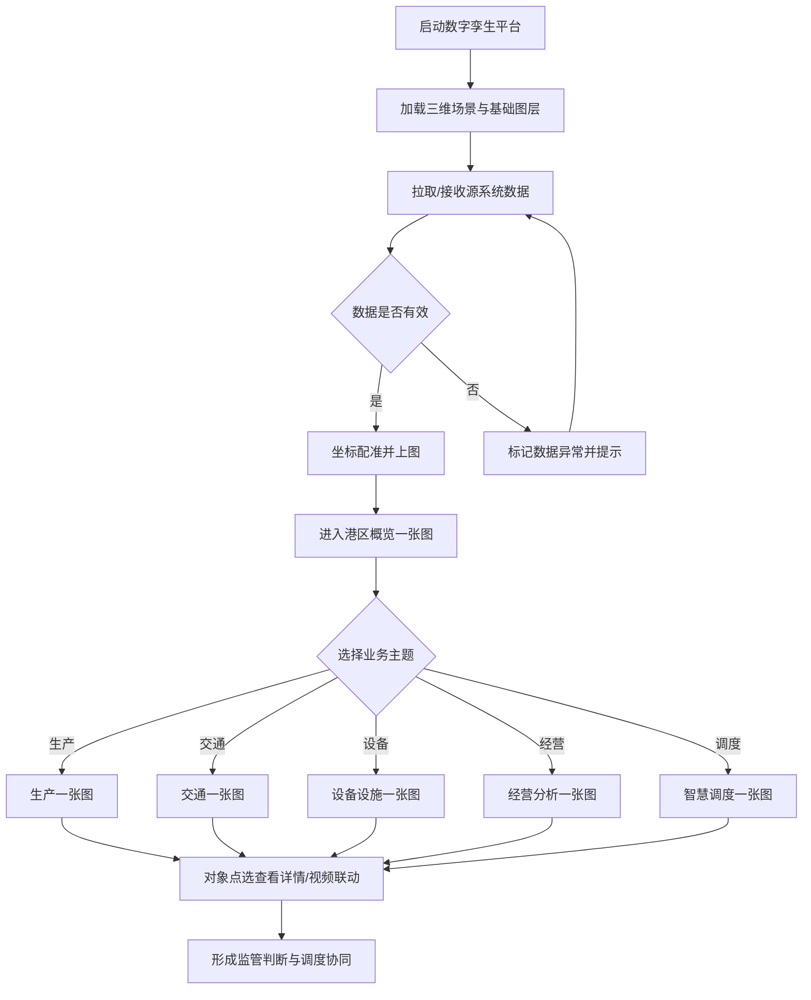
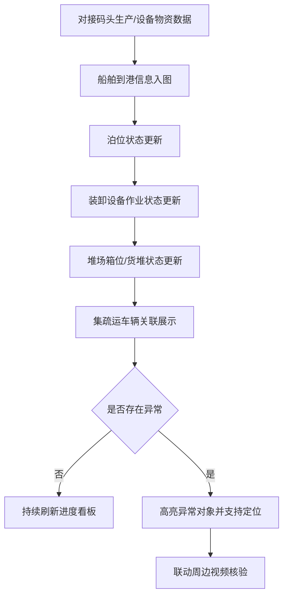
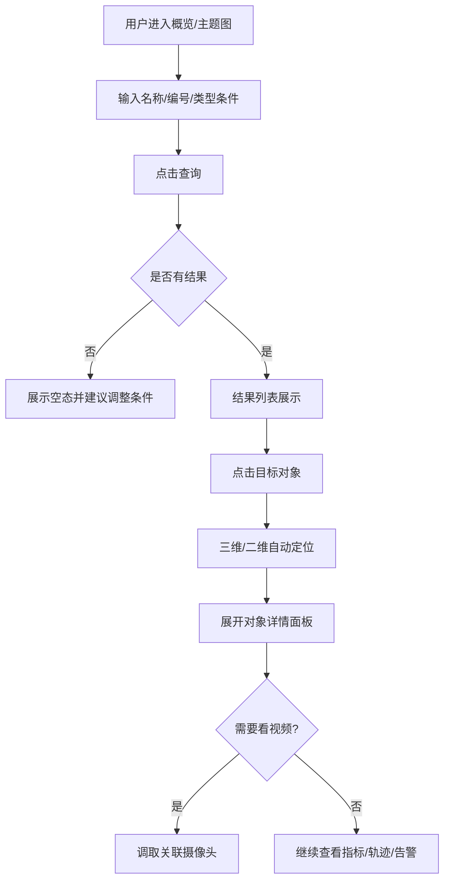
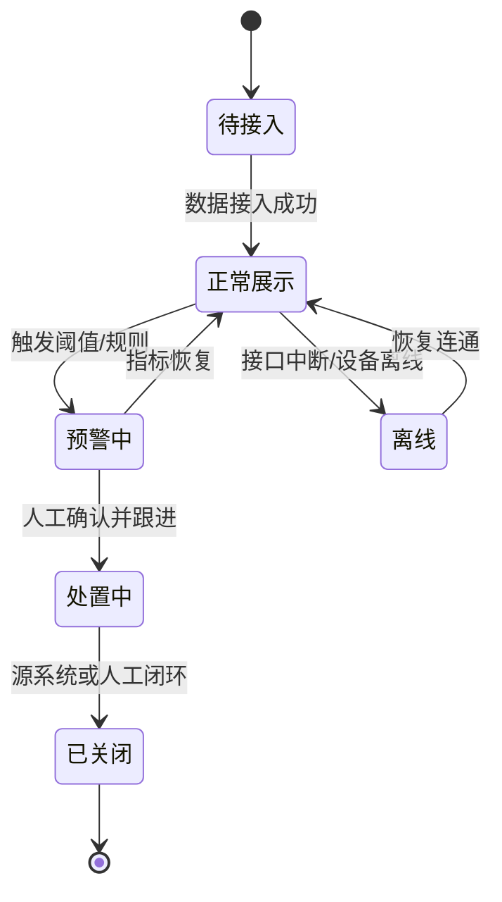
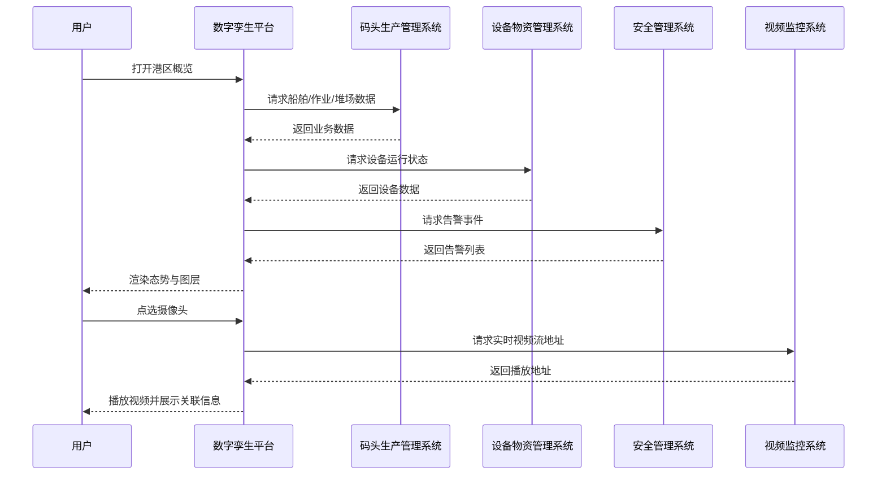
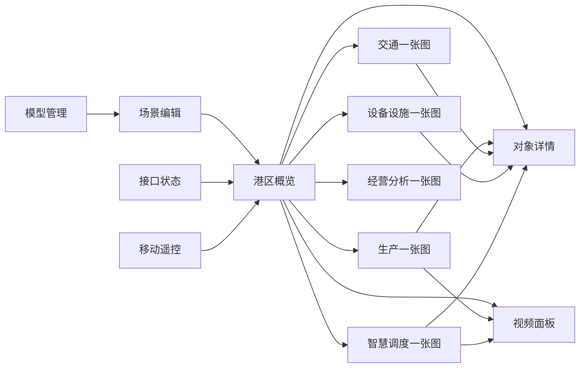

# 海南金牌港数字孪生平台 PRD

| 项目 | 内容 |
|---|---|
| 产品名称 | 海南金牌港开发区港口及配套工程项目数字孪生平台 |
| 版本号 | v1.0.0 |
| 更新时间 | 2026-11-03 |
| 版本迭代说明 | 首版 PRD；建设范围仅数字孪生平台；同步产出产品方案 |
| 依据 | 《数字孪生平台及其他系统技术规格书》、v1.0.0 产品方案 |
| 文档状态 | 待评审 |

---

## 目录

- [1. 产品概述](#1-产品概述)
- [2. 业务流程](#2-业务流程)
- [3. 功能模块](#3-功能模块)
- [4. 用户交互路径](#4-用户交互路径)
- [5. 页面清单与跳转关系](#5-页面清单与跳转关系)
- [6. 非功能性需求](#6-非功能性需求)
- [7. 本期范围与优先级](#7-本期范围与优先级)
- [8. 风险与待确认](#8-风险与待确认)

---

## 1. 产品概述

### 1.1 产品定位

面向金牌港港区指挥与运营管理场景，建设**三维数字孪生平台**，将港区空间模型与生产、交通、设备、安全、视频等业务数据融合，提供「一张图」态势感知与指挥辅助能力。

本产品以**可视化展示与空间联动**为主，不替代码头生产管理系统、设备控制系统等源业务系统的执行能力。

### 1.2 产品目标

| 目标 | 描述 | 优先级 |
|---|---|---|
| G1 空间还原 | 港区岸线、泊位、堆场、道路、设备等三维可看 | P0 |
| G2 态势统览 | 车辆、生产、设备、告警等实时汇聚可览 | P0 |
| G3 生产可视 | 靠泊-装卸-堆存-集疏运链路可追踪 | P0 |
| G4 视频联动 | 摄像头空间挂接，点选即看 | P0 |
| G5 专题深化 | 交通/设备/经营/应急专题可管可析 | P1/P2 |

### 1.3 用户角色定义

| 角色 | 职责 | 主要使用页面 |
|---|---|---|
| 指挥调度员 | 全局态势监控、异常快速定位 | 港区概览、智慧调度、大屏 |
| 生产管理员 | 关注船舶、装卸、堆场状态 | 生产一张图 |
| 交通管理员 | 关注车辆进出、拥堵与轨迹 | 交通一张图 |
| 设备管理员 | 关注设备运行与故障 | 设备设施一张图 |
| 安全管理员 | 关注告警、视频核验 | 概览、调度、视频联动 |
| 管理层 | 关注经营指标与异常波动 | 经营分析一张图 |
| 实施运维人员 | 模型导入、图层配置、接口状态巡检 | 模型管理、场景编辑 |

> 角色与组织映射待业主确认。【待确认】

### 1.4 建设边界

**包含：** 数字孪生底座、三维建模成果接入与展示、六类一张图应用、PC/大屏展示、移动遥控（若确认）。

**不包含：** OA；独立数据中台产品；源系统作业下发；消息中心/流程审批/角色权限配置（由内部统一平台承接）。

---

## 2. 业务流程

### 2.1 完整业务流程图（港区态势监管主链路）

**文字解读：** 平台先加载空间底座，再汇聚业务数据；用户从概览进入主题图，通过对象点选完成详情穿透与视频核验，支撑指挥决策。

### 2.2 子业务流程：生产作业可视

**文字解读：** 生产一张图按「船-泊位-装卸-堆场-集疏运」链路刷新；异常对象高亮并可视频复核。

### 2.3 用户交互流程图（对象检索定位）

### 2.4 流程状态机（告警/事件对象）

**文字解读：** 事件以展示态为主；闭环状态尽量跟随源系统，平台侧记录展示状态变更时间。

### 2.5 系统数据流转时序图

---

## 3. 功能模块

> 说明：以下二级功能均包含「功能介绍 / 前置条件 / 数据权限 / 页面跳转」四维描述。数据权限仅描述业务可见范围，不设计权限配置台。

### 3.1 数字孪生底座

#### 3.1.1 三维场景承载

| 维度 | 说明 |
|---|---|
| 功能介绍 | 统一承载港区大范围三维场景，还原岸线、泊位、堆场、道路、建筑与设备环境 |
| 前置条件 | 已完成基础模型导入；坐标系已确认 |
| 数据权限 | 各业务角色默认可浏览场景；模型管理操作限实施运维 |
| 页面跳转 | 登录后进入「港区概览」自动加载；可从任意一张图返回底座场景 |

#### 3.1.2 多源数据融合接入

| 维度 | 说明 |
|---|---|
| 功能介绍 | 融合 GIS、BIM、倾斜摄影、视频、物联及业务系统数据并上图 |
| 前置条件 | 源系统接口可用；空间配准参数就绪 |
| 数据权限 | 用户可见已授权业务主题图层；接口配置仅运维可见 |
| 页面跳转 | 运维从「模型/数据状态」查看接入健康；业务侧在一张图消费结果 |

#### 3.1.3 业务数据直连接入

| 维度 | 说明 |
|---|---|
| 功能介绍 | 对生产、设备、安全等已采集数据直接接入，不重复采集 |
| 前置条件 | 明确数据责任系统与接口字段 |
| 数据权限 | 按主题图授权查看对应业务对象 |
| 页面跳转 | 无独立业务页；异常时在「接口状态」页查看 |

#### 3.1.4 二三维联动

| 维度 | 说明 |
|---|---|
| 功能介绍 | 二维 GIS 与三维场景无缝切换，支持图层显隐与对象联动 |
| 前置条件 | GIS 底图与三维模型完成配准 |
| 数据权限 | 全体业务角色可用 |
| 页面跳转 | 各一张图页内切换二/三维模式 |

#### 3.1.5 三维模型管理

| 维度 | 说明 |
|---|---|
| 功能介绍 | 模型预览、导入、格式/材质/坐标自检与规范提示 |
| 前置条件 | 具备模型文件与命名规范 |
| 数据权限 | 仅实施运维可导入/发布；业务角色只读浏览 |
| 页面跳转 | `模型管理页` → 预览 → 发布到场景 |

#### 3.1.6 场景编辑

| 维度 | 说明 |
|---|---|
| 功能介绍 | 模型摆放、视角、对象聚焦、分辨率预览等编辑能力 |
| 前置条件 | 模型已导入 |
| 数据权限 | 实施运维 |
| 页面跳转 | `场景编辑页` 保存后同步概览场景 |

#### 3.1.7 移动端/大屏遥控

| 维度 | 说明 |
|---|---|
| 功能介绍 | 手机/平板扫码进入操控界面，远程控制场景、图层、视频与面板 |
| 前置条件 | 大屏会话已开启；终端形态确认 |
| 数据权限 | 授权指挥人员 |
| 页面跳转 | 扫码打开 `遥控页`，控制当前大屏会话 |

#### 3.1.8 资源中心模板

| 维度 | 说明 |
|---|---|
| 功能介绍 | 提供可复用模板与组件，加速专题图搭建 |
| 前置条件 | 模板库初始化 |
| 数据权限 | 运维可配置，业务可选用 |
| 页面跳转 | `资源中心` → 应用到目标专题页 |

### 3.2 三维建模成果展示

#### 3.2.1 港区及周边模型融合展示

| 维度 | 说明 |
|---|---|
| 功能介绍 | 展示倾斜摄影、GIS、BIM 融合后的港区整体与周边环境 |
| 前置条件 | 航测/建模成果交付并质检通过 |
| 数据权限 | 全体可浏览 |
| 页面跳转 | 概览默认加载；支持分区显隐 |

#### 3.2.2 倾斜摄影模型展示

| 维度 | 说明 |
|---|---|
| 功能介绍 | 高精度实景展示，重点区域近距可辨 |
| 前置条件 | 下视分辨率满足优于 0.05m 的成果要求 |
| 数据权限 | 全体可浏览 |
| 页面跳转 | 概览/生产图图层开关 |

#### 3.2.3 功能分区展示

| 维度 | 说明 |
|---|---|
| 功能介绍 | 生产区、堆场、仓储、物流、办公、危险品等分区分层展示 |
| 前置条件 | 分区边界资料确认 |
| 数据权限 | 全体可浏览 |
| 页面跳转 | 概览「分区图层」 |

#### 3.2.4 泊位装卸区与堆场精细模型

| 维度 | 说明 |
|---|---|
| 功能介绍 | 高精度展示泊位、装卸设备、廊道及堆场箱区结构 |
| 前置条件 | 重点区域补模完成 |
| 数据权限 | 全体可浏览；生产细节随生产数据授权 |
| 页面跳转 | 生产一张图聚焦对应区域 |

### 3.3 港区概览一张图

#### 3.3.1 多源数据融合展示

| 维度 | 说明 |
|---|---|
| 功能介绍 | 形成港区全域态势空间底座，支撑主题叠加 |
| 前置条件 | 至少完成空间底座 + 1 类核心业务数据接入 |
| 数据权限 | 指挥/各业务角色按主题可见 |
| 页面跳转 | 首页默认进入 `港区概览` |

#### 3.3.2 视频监控空间化管理

| 维度 | 说明 |
|---|---|
| 功能介绍 | 摄像头按实位点挂接，支持点选调阅、多画面与状态标识 |
| 前置条件 | 视频点位台账与流媒体接口可用 |
| 数据权限 | 授权监管角色可播放；无权限仅见点位 |
| 页面跳转 | 概览点选 → `视频播放面板` |

#### 3.3.3 港区资源要素可视

| 维度 | 说明 |
|---|---|
| 功能介绍 | 岸线、泊位、堆场、卡口、道路、仓库等统一编码分类展示 |
| 前置条件 | 主数据与空间编码就绪 |
| 数据权限 | 全体可浏览基础要素 |
| 页面跳转 | 概览图层树筛选 |

#### 3.3.4 实时态势总览

| 维度 | 说明 |
|---|---|
| 功能介绍 | 汇聚车辆、生产、设备、告警形成指挥视图 |
| 前置条件 | 对应源数据接入 |
| 数据权限 | 指挥与管理层默认可见汇总；明细按主题 |
| 页面跳转 | 概览右侧 `态势面板`；可投屏大屏页 |

#### 3.3.5 快速查询与联动定位

| 维度 | 说明 |
|---|---|
| 功能介绍 | 按名称/编号/类型检索对象并自动定位穿透 |
| 前置条件 | 对象主数据与空间关联完成 |
| 数据权限 | 仅返回角色可见对象 |
| 页面跳转 | 全局搜索 → 详情面板 |

### 3.4 生产一张图

#### 3.4.1 作业全流程可视

| 维度 | 说明 |
|---|---|
| 功能介绍 | 展示到港、靠泊、装卸、堆存、集疏运全链路 |
| 前置条件 | 码头生产管理系统接口可用 |
| 数据权限 | 生产管理员/指挥可见 |
| 页面跳转 | 概览 → `生产一张图` |

#### 3.4.2 船舶靠泊状态展示

| 维度 | 说明 |
|---|---|
| 功能介绍 | 展示船舶信息、泊位占用、计划/实际靠离泊与进度 |
| 前置条件 | 船舶与泊位数据接入 |
| 数据权限 | 生产相关角色 |
| 页面跳转 | 生产图点选船舶/泊位 → 详情 |

#### 3.4.3 装卸作业状态展示

| 维度 | 说明 |
|---|---|
| 功能介绍 | 展示卸船机/输送设备任务、效率、进度与异常 |
| 前置条件 | 设备物资管理系统提供状态 |
| 数据权限 | 生产/设备角色 |
| 页面跳转 | 生产图设备对象 → 详情 |

#### 3.4.4 堆场空间与箱位状态可视化

| 维度 | 说明 |
|---|---|
| 功能介绍 | 展示箱区贝位排层及占用、空闲、计划、异常状态 |
| 前置条件 | 堆场布局与库存数据接入 |
| 数据权限 | 生产角色 |
| 页面跳转 | 生产图堆场区域下钻 |

#### 3.4.5 设备作业状态监控

| 维度 | 说明 |
|---|---|
| 功能介绍 | 设备空间挂接并查看实时状态、任务与效率 |
| 前置条件 | 设备状态接口 |
| 数据权限 | 设备/生产角色 |
| 页面跳转 | 生产图或设备图互跳 |

### 3.5 交通一张图

#### 3.5.1 车辆全域监管

| 维度 | 说明 |
|---|---|
| 功能介绍 | 统一接入作业车、运输车、社会车等并分类监管 |
| 前置条件 | 道闸/卡口/定位数据 |
| 数据权限 | 交通/指挥角色 |
| 页面跳转 | `交通一张图` |

#### 3.5.2 卡口道闸联动

| 维度 | 说明 |
|---|---|
| 功能介绍 | 展示进出记录、抓拍、识别结果与放行状态 |
| 前置条件 | 卡口系统接口 |
| 数据权限 | 交通角色 |
| 页面跳转 | 交通图卡口对象 → 通行记录 |

#### 3.5.3 交通流量实时监测

| 维度 | 说明 |
|---|---|
| 功能介绍 | 监测关键道路、闸口、堆场出入口通行情况 |
| 前置条件 | 视频识别或通行数据 |
| 数据权限 | 交通/指挥 |
| 页面跳转 | 交通图流量图层 |

#### 3.5.4 车辆轨迹与路径分析

| 维度 | 说明 |
|---|---|
| 功能介绍 | 记录、回放并分析车辆运行轨迹 |
| 前置条件 | 定位或卡口过车数据 |
| 数据权限 | 交通角色 |
| 页面跳转 | 车辆详情 → 轨迹回放 |

#### 3.5.5 拥堵识别与预警

| 维度 | 说明 |
|---|---|
| 功能介绍 | 识别关键节点拥堵并预警提示 |
| 前置条件 | 拥堵规则与数据源确认 |
| 数据权限 | 交通/指挥 |
| 页面跳转 | 预警列表 → 地图定位 |

### 3.6 设备设施一张图

#### 3.6.1 运行状态实时监测

| 维度 | 说明 |
|---|---|
| 功能介绍 | 展示设备在线、运行、负载、能耗、故障等状态 |
| 前置条件 | 设备物资/控制系统数据 |
| 数据权限 | 设备角色 |
| 页面跳转 | `设备设施一张图` |

#### 3.6.2 健康评估与故障预警

| 维度 | 说明 |
|---|---|
| 功能介绍 | 基于运行与传感器数据评估健康并预警 |
| 前置条件 | 传感器与评估规则【待确认】 |
| 数据权限 | 设备角色 |
| 页面跳转 | 预警列表 → 设备详情 |

#### 3.6.3 设备利用率分析

| 维度 | 说明 |
|---|---|
| 功能介绍 | 统计开机、作业、空闲、故障及时长效率 |
| 前置条件 | 运行与维保数据 |
| 数据权限 | 设备/管理层 |
| 页面跳转 | 设备图分析面板 |

### 3.7 经营分析一张图

#### 3.7.1 关键经营指标展示

| 维度 | 说明 |
|---|---|
| 功能介绍 | 展示吞吐量、船时效率、泊位与堆场利用。不含收入、成本、利润 |
| 前置条件 | 生产与经营数据口径确认 |
| 数据权限 | 管理层/经营分析角色 |
| 页面跳转 | `经营分析一张图` |

#### 3.7.2 多维度数据分析

| 维度 | 说明 |
|---|---|
| 功能介绍 | 按时间、区域、货类、泊位、设备等组合分析 |
| 前置条件 | 主题指标数据就绪 |
| 数据权限 | 管理层 |
| 页面跳转 | 经营图筛选器 → 图表区 |

#### 3.7.3 经营异常监测预警

| 维度 | 说明 |
|---|---|
| 功能介绍 | 对核心经营指标波动自动监测预警 |
| 前置条件 | 阈值规则确认【待确认】 |
| 数据权限 | 管理层 |
| 页面跳转 | 预警卡片 → 指标下钻 |

### 3.8 智慧调度一张图

#### 3.8.1 突发事件快速定位

| 维度 | 说明 |
|---|---|
| 功能介绍 | 告警事件空间定位并展示类型、级别、状态 |
| 前置条件 | 安全/生产/设备告警接入 |
| 数据权限 | 指挥/安全角色 |
| 页面跳转 | `智慧调度一张图` / 概览告警入口 |

#### 3.8.2 应急资源调度

| 维度 | 说明 |
|---|---|
| 功能介绍 | 应急人员、车辆、物资可视化查询与就近查看 |
| 前置条件 | 安全管理系统资源台账 |
| 数据权限 | 指挥/安全 |
| 页面跳转 | 事件详情 → 周边资源 |

#### 3.8.3 多系统联动指挥

| 维度 | 说明 |
|---|---|
| 功能介绍 | 联动视频、广播、通信、报警等支撑处置过程可视化 |
| 前置条件 | 相关系统联动接口【待确认】 |
| 数据权限 | 指挥角色 |
| 页面跳转 | 事件工作台 → 联动操作区 |

> 注：联动指令若涉及审批/消息，复用内部统一平台，本 PRD 不设计审批流页面。

---

## 4. 用户交互路径

### 4.1 主路径：日常值班监管（正常）

1. 打开平台进入港区概览  
2. 查看态势面板与告警摘要  
3. 切换生产/交通等主题图  
4. 检索或点选对象查看详情  
5. 必要时调取视频核验  

### 4.2 主路径：生产异常追踪（正常）

1. 生产一张图发现装卸进度异常高亮  
2. 点选设备/船舶查看详情  
3. 联动周边摄像头确认现场  
4. 记录问题并转源系统处理（平台外协同）  

### 4.3 异常分支

| 场景 | 用户路径 | 系统表现 |
|---|---|---|
| 接口中断 | 概览仍可打开 | 对应图层提示离线与最后更新时间 |
| 无检索结果 | 调整关键词 | 空态引导 |
| 视频离线 | 点选摄像头 | 标红并提示离线，可看点位信息 |
| 模型未覆盖区域 | 缩放至边缘 | 显示未建模提示 |

### 4.4 边界条件

| 条件 | 处理 |
|---|---|
| 仅完成概览+生产接入 | 其他主题入口可见但标记「未启用」 |
| 大屏与 PC 同时在线 | 支持会话绑定遥控，避免多端冲突【待确认】 |
| 高峰数据量 | 聚合展示 + 分档刷新，详情按需加载 |

---

## 5. 页面清单与跳转关系

### 5.1 页面清单

| 页面ID | 页面名称 | 端 | 优先级 | 说明 |
|---|---|---|---|---|
| P-HOME | 港区概览一张图 | PC/大屏 | P0 | 默认首页 |
| P-PROD | 生产一张图 | PC/大屏 | P0 | 生产主题 |
| P-TRAFFIC | 交通一张图 | PC/大屏 | P1 | 交通主题 |
| P-EQUIP | 设备设施一张图 | PC/大屏 | P1 | 设备主题 |
| P-BIZ | 经营分析一张图 | PC/大屏 | P1 | 经营主题 |
| P-DISP | 智慧调度一张图 | PC/大屏 | P1 | 应急调度 |
| P-MODEL | 模型管理 | PC | P0 | 运维 |
| P-SCENE | 场景编辑 | PC | P1 | 运维 |
| P-RES | 资源中心 | PC | P1 | 模板组件 |
| P-STATUS | 接口与数据状态 | PC | P0 | 运维巡检 |
| P-VIDEO | 视频播放面板 | PC/大屏 | P0 | 可悬浮面板 |
| P-DETAIL | 对象详情面板 | PC/大屏 | P0 | 通用详情 |
| P-REMOTE | 移动遥控页 | 移动 | P1 | 扫码操控【待确认】 |
| P-SCREEN | 指挥大屏布局页 | 大屏 | P0 | 投屏布局 |

### 5.2 跳转关系

---

## 6. 非功能性需求

| 类别 | 要求 |
|---|---|
| 性能 | 常规操作反馈宜 ≤2 秒；专题图首屏可交互时间应可接受；详情按需加载 |
| 并发 | 满足规格书并发与查询时延目标（以部署环境压测报告为准） |
| 安全 | 无高危漏洞；上线前安全扫描；敏感传输走 HTTPS |
| 兼容 | Chrome/Edge/Firefox/360；支持国产操作系统与国产数据库部署环境 |
| 可用性 | 7×24；接口失败可降级；关键操作可追溯日志 |
| 可扩展 | 主题图与图层可配置扩展；预留第三方接口 |
| 备份 | 支持数据备份策略（结合业主机房） |

> 详细指标对齐技术规格书 4.7 章；以合同环境为准。

---

## 7. 本期范围与优先级

### 7.1 建议一期（P0）必做

- 孪生底座（场景、融合、二三维、模型管理）
- 三维建模成果接入展示
- 港区概览一张图（含视频空间化、态势、检索）
- 生产一张图（全流程、靠泊、装卸、堆场）
- 接口与数据状态、对象详情、视频面板、指挥大屏

### 7.2 建议二期（P1）

- 交通一张图主体能力
- 设备运行监测
- 经营指标与多维分析
- 突发事件定位
- 场景编辑、资源中心、移动遥控

### 7.3 建议三期（P2）

- 拥堵预警、健康评估、利用率分析
- 经营异常预警
- 应急资源调度与多系统联动指挥

---

## 8. 风险与待确认

### 8.1 风险项

| 风险 | 说明 | 建议 |
|---|---|---|
| 接口依赖强 | 无源数据则一张图空心化 | 启动会锁定联调计划 |
| 范围过宽 | 规格书全量易验收争议 | 以分期清单作为验收附件 |
| 口径未定 | 箱位/指标/预警规则不清 | 专项确认业务字典 |
| 建模延期 | 影响真实感与上线观感 | 先保重点作业区 |

### 8.2 【待确认】

1. 一期验收是否仅「底座+概览+生产」？  
2. 海关通关辅助系统是否本期对接？  
3. 终端是否包含独立 App / 企微 H5，或仅 PC+大屏+简易遥控？  
4. 统一坐标系、港区边界、建模包络确认时间？  
5. P2 预警与应急联动是否纳入合同必验？  
6. 经营指标口径已确认：仅生产运营（吞吐、船时效率、泊位与堆场利用），不含收入、成本、利润。  

---

## 附录 A. 与产品方案关系

本 PRD 与 `产品方案.md` 配套：产品方案用于范围与分期对齐，PRD 用于需求详述与原型设计输入。
