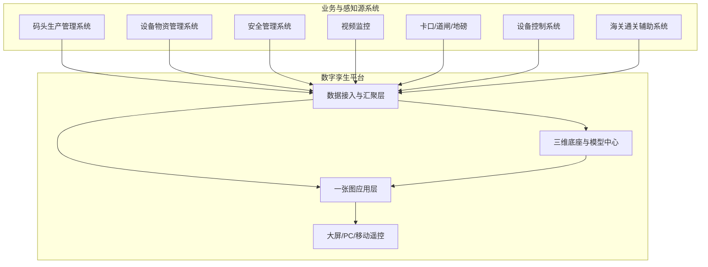

# 海南金牌港数字孪生平台产品方案

| 项目 | 内容 |
|---|---|
| 项目名称 | 海南金牌港开发区港口及配套工程项目数字孪生平台 |
| 文档类型 | 产品方案（v1.0.0） |
| 版本号 | v1.0.0 |
| 更新日期 | 2026-11-03 |
| 版本说明 | 首版产品方案，建设范围仅含数字孪生平台；完整 PRD 见同目录 `prd.md` |
| 依据文档 | 《数字孪生平台及其他系统技术规格书》 |

---

## 1. 结论摘要

本方案面向金牌港一期码头前期运营，建设**港区数字孪生平台**，形成「三维底座 + 多张业务一张图」能力，支撑港区全域态势感知、生产可视、交通监管、设备监测、经营分析与应急调度。

| 维度 | 结论 |
|---|---|
| 产品定位 | 港区三维可视化与业务态势融合平台（展示与联动为主，不替代生产执行系统） |
| 本期范围 | **仅数字孪生平台**（不含 OA、不含独立数据中台产品化建设） |
| 核心价值 | 一图统览、空间定位、多系统数据融合展示、指挥辅助 |
| 关键依赖 | 码头生产、设备物资、安全管理、视频、卡口/道闸、地磅、控制系统等接口 |
| 指挥大屏 | 兴盛单墙启用拼接；16:9；约29㎡；5760×3200；单箱**12×12**；**5 分屏槽位**；**最小支持拖动具体模块**；详见 `大屏拼接方案.md` |
| 建设节奏 | 大屏与孪生主题 **一期全做**（硬件参数后续补充） |

---

## 2. 背景与目标

### 2.1 背景

金牌港项目位于临高金牌港开发区，新建 2 个 7 万吨级通用泊位（水工结构按靠泊 10 万吨级散货船设计），年设计吞吐量 700 万吨。为保障码头前期运营有序高效，需建设先进可靠的港口信息化数字孪生平台。

### 2.2 产品目标

| 目标 | 说明 | 优先级 |
|---|---|---|
| 空间可视 | 还原港区岸线、泊位、堆场、道路、设备及周边环境 | P0 |
| 态势统览 | 汇聚生产、车辆、设备、告警，形成指挥大屏视图 | P0 |
| 生产可视 | 船舶靠泊、装卸、堆场箱位等关键环节空间化展示 | P0 |
| 监管联动 | 视频点选即看，异常事件地图定位 | P0 |
| 分析辅助 | 经营指标、设备利用率、交通拥堵等分析预警 | P1/P2 |
| 应急支撑 | 突发事件定位、应急资源可视、多系统联动指挥 | P1/P2 |

---

## 3. 产品定位与边界

### 3.1 定位一句话

**港口数字孪生平台 = 三维空间底座 + 业务数据上图 + 一张图指挥辅助。**

### 3.2 包含范围（本期）

| 模块 | 是否本期 | 说明 |
|---|---|---|
| 数字孪生底座 | 是 | 场景承载、模型管理、二三维联动、多源融合 |
| 三维建模成果接入 | 是 | 倾斜摄影/BIM/人工模型融合展示（采集由项目组织实施） |
| 港区概览一张图 | 是 | 资源要素、视频空间化、实时态势、检索定位 |
| 生产一张图 | 是 | 作业全流程、靠泊、装卸、堆场箱位 |
| 交通一张图 | 是（建议分期） | 车辆监管、流量、轨迹、拥堵预警 |
| 设备设施一张图 | 是（建议分期） | 运行监测、健康评估、利用率 |
| 经营分析一张图 | 是（建议分期） | 指标展示、多维分析、异常预警 |
| 智慧调度一张图 | 是（建议分期） | 事件定位、应急资源、联动指挥 |

### 3.3 不包含范围

| 不包含 | 说明 |
|---|---|
| OA 管理系统 | 本期不做 |
| 独立数据存储与管理系统（产品化） | 本期不做独立数据中台产品；孪生所需数据通过接口接入与平台侧汇聚 |
| 码头生产执行、设备控制闭环下发 | 以接入展示为主，不替代源系统作业下发 |
| 消息中心 / 流程审批 / 角色权限配置台 | 由公司统一内部平台承接，本方案不设计 |

---

## 4. 用户角色（业务视角）

| 角色 | 主要诉求 | 常用模块 |
|---|---|---|
| 指挥调度人员 | 一屏掌握港区运行态势，快速定位异常 | 概览、生产、调度 |
| 生产管理人员 | 看船舶、装卸、堆场进度与堵点 | 生产一张图 |
| 交通管理人员 | 看进出港车辆、拥堵与轨迹 | 交通一张图 |
| 设备运维人员 | 看设备状态、故障与利用率 | 设备设施一张图 |
| 安全管理人员 | 看告警、视频与事件位置 | 概览、调度 |
| 管理层 | 看吞吐量、效率、经营异常 | 经营分析一张图 |

> 角色清单待业主确认组织编制后固化。【待确认】

---

## 5. 总体架构（业务架构）

**文字解读：**
- 源系统负责采集与业务管理；孪生平台不重复采集同类业务数据。
- 接入层完成协议适配、字段映射与刷新；底座负责空间融合；应用层按主题输出一张图。
- 端侧以 PC 与指挥大屏为主，移动端侧重场景遥控。【待确认终端形态】

---

## 6. 功能模块总览

| 一级模块 | 二级能力 | 优先级 | 核心价值 |
|---|---|---|---|
| 孪生底座 | 场景承载、多源融合、二三维联动、模型管理 | P0 | 空间底座 |
| 三维建模 | 倾斜模型、分区、泊位装卸区、堆场 | P0 | 真实还原 |
| 港区概览一张图 | 融合展示、视频空间化、资源可视、态势、检索 | P0 | 全域感知 |
| 生产一张图 | 全流程、靠泊、装卸、堆场箱位、设备作业 | P0/P1 | 生产可视 |
| 交通一张图 | 车辆监管、道闸联动、流量、轨迹、拥堵 | P1/P2 | 交通组织 |
| 设备设施一张图 | 运行监测、健康预警、利用率 | P1/P2 | 设备可靠 |
| 经营分析一张图 | 指标、多维分析、异常预警 | P1/P2 | 经营决策 |
| 智慧调度一张图 | 事件定位、应急资源、联动指挥 | P1/P2 | 应急协同 |

详细功能点、前置条件与页面交互见 `prd.md`。

---

## 7. 建议分期

| 阶段 | 目标 | 模块 | 说明 |
|---|---|---|---|
| 一期（最基本配置） | 可看、可查、可指挥 | 底座+建模+概览+生产 | 满足前期运营监管 |
| 二期 | 可管、可析 | 交通+设备运行监测+经营指标 | 在接口成熟后扩展 |
| 三期 | 可预、可调 | 拥堵/健康/经营预警+应急联动 | 依赖规则与多系统联动条件 |

> 分期裁剪需业主确认，避免规格书全量同等验收。【待确认】

---

## 8. 关键依赖与前置条件

| 类别 | 前置事项 |
|---|---|
| 组织接口 | 明确业主项目负责人、业务/信息化接口人 |
| 范围确认 | 确认本期一张图清单与验收边界 |
| 空间资料 | 港区边界、总平、CAD/GIS、BIM、建模范围 |
| 坐标系 | 统一坐标系与高程基准选型 |
| 系统联调 | 生产/设备/安全/视频/卡口等厂商接口开放 |
| 部署环境 | 服务器、网络、大屏、国产化要求 |

---

## 9. 正常 / 边界 / 异常场景

### 9.1 正常流程

源系统正常推送或拉取数据 → 孪生汇聚上图 → 用户在概览/主题图查看、检索、点选视频与对象详情。

### 9.2 边界情况

| 场景 | 处理原则 |
|---|---|
| 某类接口暂未就绪 | 对应图层置灰/提示「数据未接入」，不影响其他主题可用 |
| 模型分批交付 | 支持分区加载与占位，先保证重点作业区 |
| 海关系统是否本期对接 | 未确认前不作为一期硬依赖 |

### 9.3 异常兜底

| 场景 | 兜底 |
|---|---|
| 接口中断 | 展示最后成功时间，告警提示，保留最近缓存 |
| 视频离线 | 点位标红，支持查看历史状态 |
| 坐标漂移 | 提供校准入口与问题清单，不阻断其他图层 |

---

## 10. 风险项

| 风险 | 影响 | 应对 |
|---|---|---|
| 接口开放滞后 | 一张图空洞 | 启动会锁定联调窗口与责任人 |
| 建模范围不清 | 返工与延期 | 先确认港区边界与本期包络 |
| 规格书范围过宽 | 验收争议 | 以分期清单作为合同/验收附件 |
| 业务口径未定 | 指标与箱位展示不准 | 专项确认指标字典与堆场规则 |

---

## 11. 【待确认】

1. 本期验收一张图是否仅「概览+生产」，其余二期？
2. 海关通关辅助系统是否本期对接？
3. 终端形态：仅 PC+大屏，还是含独立 App / 企微 H5 遥控？
4. 统一坐标系与港区边界资料提供时间？
5. 拥堵预警、设备健康评估、经营异常预警、应急联动是否纳入本期必验？

---

## 12. 指挥大屏（摘要）

> 完整文字方案见 `大屏拼接方案.md`。硬件细项后续补充。

| 项 | 口径 |
|---|---|
| 形态 | 单墙启用拼接：5 个分屏槽位（顶/左/中/右/底） |
| 组合 | 中央孪生主视 + 左右业务模块 + 底栏主题切换 |
| 模块 | 主题预设包 + **可拖动具体模块**投放/排序/迁移/下墙 |
| 主题（一期） | 概览、生产、交通、设备、经营、调度 |

## 13. 配套文档

| 文档 | 路径 |
|---|---|
| 完整 PRD | `docs/versions/v1.0.0/prd.md` |
| 大屏拼接方案（文字版） | `docs/versions/v1.0.0/大屏拼接方案.md` |
| 功能清单（前期） | `资料/海南金牌港数字孪生平台项目功能清单.xlsx` |
| 启动协调函 | `资料/海南金牌港数字孪生平台项目启动协调事项清单.docx` |
