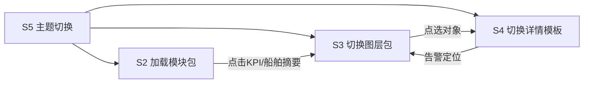

# 海南金牌港数字孪生平台 — 大屏拼接方案（文字版）

| 项目 | 内容 |
|---|---|
| 版本号 | v1.0.0 |
| 更新日期 | 2026-11-03 |
| 文档状态 | 文字方案（屏体硬件细节后续补充） |
| 适用产品 | 数字孪生平台指挥大屏 |
| 屏体形态 | **单墙启用拼接**（兴盛大屏） |
| 最小交互 | **支持拖动具体业务模块** |
| 建设节奏 | **一期全做**（不区分二期裁剪） |

---

## 1. 结论摘要

本方案采用「**启用拼接方案：1 面物理墙 + 5 个逻辑分屏槽位 + N 个可拖拽业务模块**」：

- 物理上：一块兴盛大屏整墙输出；
- 逻辑上：**启用拼接布局**——固定 5 个分屏槽位（S1–S5）作为投放区域；
- 交互上：**最小能力 = 支持拖动具体业务模块**（拖入/拖出分屏槽位、同槽位内排序、跨槽位迁移）；
- 业务上：概览 / 生产 / 交通 / 设备 / 经营 / 调度均在一期纳入，通过**主题预设包 + 模块拖拽微调**呈现。

| 项 | 口径 |
|---|---|
| 比例 | 16:9 |
| 面积 | 约 29㎡（后续以兴盛终版为准） |
| 设计分辨率 | **5760 × 3200（宽 × 高）** |
| 单箱体规格 | **12×12**（兴盛箱体；单位含义见 §9，待终认） |
| 拼接方式 | 单墙逻辑分屏拼接（非武穴式左右双物理屏） |
| 硬件参数 | 【后续补充】点间距、箱体阵列总数、控制器、信号链路等 |

---

## 2. 整体组合样式（整墙）

### 2.1 整墙结构示意（5760 × 3200）

```text
┌──────────────────────────────────────────────────────────────┐
│ S1 顶栏分屏（通栏）                                            │
│ 项目名称 / 时间天气 / 数据截至                                  │
├──────────────┬─────────────────────────────┬─────────────────┤
│              │                             │                 │
│ S2 左侧分屏   │      S3 中央主视分屏          │   S4 右侧分屏    │
│ （指标+列表） │   （三维孪生 / GIS 主视觉）    │ （明细+告警+视频）│
│              │                             │                 │
├──────────────┴─────────────────────────────┴─────────────────┤
│ S5 底栏分屏（通栏）                                            │
│ 主题切换：概览 | 生产 | 交通 | 设备 | 经营 | 调度  + 快捷状态   │
└──────────────────────────────────────────────────────────────┘
```

### 2.2 建议像素占位（可微调）

| 分屏 | 建议像素区域（宽×高） | 约占整墙 |
|---|---|---|
| S1 顶栏 | 5760 × 160 | 约 5% 高 |
| S2 左侧 | 1150 × 2720 | 约 20% 宽 |
| S3 中央 | 3460 × 2720 | 约 60% 宽 |
| S4 右侧 | 1150 × 2720 | 约 20% 宽 |
| S5 底栏 | 5760 × 320 | 约 10% 高 |

> 说明：上述为**逻辑栅格**，最终以兴盛控制器窗口与前端自适应为准；允许 ±5% 微调，但须保持「中主视、左右辅、上下通栏」结构。

### 2.3 整墙视觉风格（统一）

| 规范项 | 要求 |
|---|---|
| 风格 | 政务科技风、沉稳、远距可读（对齐武穴大屏经验，比例改为 16:9） |
| 主色 | 深蓝底 `#051838`；科技蓝 `#0E74F0`；高亮青 `#00E4FF` |
| 状态色 | 正常绿 `#00C48C`；预警黄 `#FFAA00`；告警红 `#F53F3F` |
| 卡片 | 半透明深色卡片、细蓝边、圆角 8px、避免花哨动效 |
| 动效 | 轻量渐入、数据刷新；禁止高频闪烁 |
| 字体 | 微软雅黑 / 思源黑体；标题加粗，数字放大 |

---

## 3. 分屏清单（共 5 个）

| 编号 | 分屏名称 | 职责 | 默认是否常驻 |
|---|---|---|---|
| S1 | 顶栏分屏 | 身份识别、时间、环境、全局提示 | 是 |
| S2 | 左侧分屏 | KPI、排行、关键列表摘要 | 是 |
| S3 | 中央主视分屏 | 三维孪生/二维 GIS 主场景与对象定位 | 是 |
| S4 | 右侧分屏 | 对象明细、告警、视频、作业进度 | 是 |
| S5 | 底栏分屏 | 主题切换、模块编排入口、系统状态 | 是 |

---

## 4. 各分屏样式与模块要求

> 约定：每个分屏内由若干**业务模块（M）**组成；模块可在同侧分屏内上下重排，也可按规则跨分屏迁移（见第 5 章）。

### 4.1 S1 顶栏分屏

**样式：** 通栏横条；左信息、中标题、右环境与状态；高度克制，不抢主视。不设迎宾 / 常态 / 应急切换。

| 模块ID | 模块名称 | 内容要求 | 可拆分组合 |
|---|---|---|---|
| M-S1-01 | 时钟天气 | 日期、星期、时分秒、数据截至时间 | 可隐藏天气 |
| M-S1-02 | 主标题 | 「海南金牌港数字孪生指挥中心」类标题 | 文案可配置 |
| M-S1-04 | 全局提示条 | 接口异常、重大告警跑马摘要 | 可与告警模块联动显隐 |

### 4.2 S2 左侧分屏

**样式：** 纵向卡片栈；上 KPI 翻牌/数字卡，下图表或精简列表；支持内部滚动，但默认一屏可见核心指标。

| 模块ID | 模块名称 | 内容要求 | 可拆分组合 |
|---|---|---|---|
| M-S2-01 | 核心 KPI 组 | 年/月/日吞吐、在港船舶、泊位利用率、今日车辆等 | 可按主题替换指标组 |
| M-S2-02 | 完成率/进度 | 目标完成率、进度条 | 可并入 KPI 组 |
| M-S2-03 | 趋势微图 | 近 7 日/24 小时吞吐或作业趋势 | 可与排行互换位置 |
| M-S2-04 | 货类/作业排行 | TOP 排行条形图 | 可迁到 S4 |
| M-S2-05 | 在泊/待泊摘要 | 船名、泊位、进度摘要表 | 可与 S4 明细互为主从 |

**主题适配（一期全做）：**

| 底栏主题 | S2 默认模块组合 |
|---|---|
| 概览 | KPI 组 + 完成率 + 趋势微图 |
| 生产 | KPI（船/泊位/装卸）+ 在泊摘要 + 排行 |
| 交通 | KPI（车流/闸口）+ 拥堵摘要 + 趋势 |
| 设备 | KPI（在线/故障）+ 设备排行 + 微趋势 |
| 经营 | KPI（吞吐/效率/利用率）+ 指标卡 |
| 调度 | KPI（事件数/闭环率）+ 告警摘要 |

### 4.3 S3 中央主视分屏

**样式：** 整墙视觉中心；深色场景；悬浮图层控件与图例；点击对象驱动左右分屏。

| 模块ID | 模块名称 | 内容要求 | 可拆分组合 |
|---|---|---|---|
| M-S3-01 | 三维孪生主场景 | 港区三维底座、分区、重点设施 | 主模块，不建议移除 |
| M-S3-02 | 二维 GIS 模式 | 与三维切换/联动 | 可与三维二选一默认 |
| M-S3-03 | 图层树 | 泊位/堆场/道路/设备/视频/告警等开关 | 可收纳为抽屉 |
| M-S3-04 | 图例与状态条 | 颜色含义、刷新状态 | 可贴边迷你化 |
| M-S3-05 | 框选/定位工具 | 检索定位、视角复位 | 可并入底栏快捷 |
| M-S3-06 | 场景标注层 | 热力、轨迹、作业动画 | 按主题启停 |

**交互原则：**  
S3 点选船舶/泊位/设备/摄像头/告警 → S4 打开对应详情；必要时 S2 同步高亮相关 KPI。

### 4.4 S4 右侧分屏

**样式：** 详情面板栈；上详情卡，中列表，下视频或告警；支持 Tab 切换。

| 模块ID | 模块名称 | 内容要求 | 可拆分组合 |
|---|---|---|---|
| M-S4-01 | 对象详情卡 | 名称、编号、状态、关键指标、关联资源 | 随点选对象类型切换模板 |
| M-S4-02 | 作业进度/任务 | 装卸进度、任务清单 | 生产主题默认开 |
| M-S4-03 | 告警列表 | 等级、点位、时间、状态 | 可置顶或沉底 |
| M-S4-04 | 视频面板 | 单路/多路、点选即看 | 可拆成底栏视频条 |
| M-S4-05 | 轨迹/历史 | 车辆轨迹、进出记录 | 交通主题默认开 |
| M-S4-06 | 经营图表 | 指标卡+对比图 | 经营主题默认开 |
| M-S4-07 | 应急资源 | 周边人员/车辆/物资 | 调度主题默认开 |

### 4.5 S5 底栏分屏

**样式：** 通栏工具条；主题切换为主，辅以系统状态与模块编排入口。

| 模块ID | 模块名称 | 内容要求 | 可拆分组合 |
|---|---|---|---|
| M-S5-01 | 主题切换器 | 概览/生产/交通/设备/经营/调度 | 一期全开 |
| M-S5-02 | 模块编排入口 | 打开「模块组合配置」（运维/讲解模式） | 可仅管理员可见 |
| M-S5-03 | 接口健康灯 | 生产/设备/安全/视频等接入状态 | 可迁到顶栏 |
| M-S5-04 | 快捷动作 | 复位视角、清空选中 | 可增删 |
| M-S5-05 | 视频缩略条 | 4–6 路关键点位 | 可与 S4 视频互斥，二选一常驻 |

---

## 5. 拼接启用与模块拖拽规则

### 5.0 启用拼接方案（产品定义）

| 层级 | 含义 | 本期要求 |
|---|---|---|
| 物理拼接 | 兴盛箱体拼成整墙 | 硬件后续补充；单箱 12×12 |
| 逻辑拼接 | 整墙划分为 S1–S5 分屏槽位 | **启用**（默认开启） |
| 模块拼接 | 业务模块投放进槽位并组合 | **启用**；支持预设一键加载 |
| 最小交互 | 拖动具体模块调整布局 | **必须支持**（P0） |

**最小可用标准（验收口径）：**

1. 可从模块库 / 已上墙模块中，**按住拖动某一个具体模块**；  
2. 可拖入允许的分屏槽位，松手后完成投放；  
3. 可在同一分屏内上下拖动调整顺序；  
4. 可拖到另一允许分屏完成迁移（受 §5.3 约束）；  
5. 可拖出到回收区 / 关闭，实现下墙；  
6. 拖拽结果可保存为「自定义预设」，不影响五分屏骨架。

> 说明：拖拽调整的是**业务模块**，不是拆掉 S1–S5 骨架；中央主视模块（M-S3-01）默认锁定，不可拖离 S3（可配置解锁给运维）。

### 5.1 组合原则

1. **主视优先：** S3 始终保留孪生/GIS 主场景，不被列表类模块挤占。  
2. **左右可换肤：** S2/S4 按主题加载预设模块包，不改整墙骨架。  
3. **单模块单实例：** 同一模块同时只出现在一个分屏槽位（避免重复刷新）。  
4. **降级可点灭：** 某数据源未就绪时，对应模块显示「未接入」占位，不影响其它模块。  
5. **拖拽优先于手工配置：** 日常调整以拖模块为主；深度参数仍走配置项。

### 5.2 推荐预设组合（一期）

| 预设名称 | S2 | S3 | S4 | S5 |
|---|---|---|---|---|
| 概览 | KPI + 趋势 | 三维+全图层 | 告警 + 视频 | 全主题 |
| 生产 | 在泊摘要 + 排行 | 生产图层 | 船舶/装卸详情 + 进度 | 主题=生产 |
| 交通 | 车流 KPI + 拥堵 | 交通图层 | 车辆详情 + 轨迹 | 主题=交通 |
| 设备 | 设备 KPI + 排行 | 设备图层 | 设备详情 + 状态 | 主题=设备 |
| 经营 | 经营 KPI | 概览底图 | 经营图表 | 主题=经营 |
| 调度 | 事件 KPI | 事件定位高亮 | 告警置顶 + 视频 + 应急资源 | 主题=调度 |

### 5.3 允许的跨分屏迁移

| 模块类型 | 默认可放置 | 允许迁移至 |
|---|---|---|
| KPI/排行/趋势 | S2 | S4 上部 |
| 告警列表 | S4 | S2 下部、S1 摘要 |
| 视频 | S4 | S5 缩略条、S3 角落小窗（限制 1 路） |
| 详情卡 | S4 | 不可迁到 S3（避免遮挡主视过大） |
| 主题切换 | S5 | 不可移除 |

### 5.4 禁止组合（避免可用性下降）

- 同时在 S3 叠放超过 1 路常驻大视频窗（遮挡孪生）。  
- S2/S4 同时堆叠超过 6 个独立卡片（远距不可读）。  
- 将主题切换器（M-S5-01）拖离 S5 或下墙。  
- 将锁定的中央主视（M-S3-01）拖离 S3（非运维解锁状态）。

### 5.5 拖拽交互说明（文字）

| 操作 | 行为 |
|---|---|
| 拖模块到空槽位 | 投放成功，按槽位默认宽度铺满 |
| 拖模块到已有模块上方/下方 | 插入排序 |
| 拖到非法槽位 | 回弹并提示「该模块不可放入此分屏」 |
| 拖到回收区 | 模块下墙，回到模块库 |
| 双击模块标题 | 快速固定/解锁（防止误拖）【待确认是否需要】 |
| 一键恢复预设 | 丢弃未保存拖拽，回到当前主题官方包 |  

---

## 6. 分屏联动关系



**文字解读：**  
底栏决定「看什么主题」，中央负责「看哪里」，左右负责「看什么数/看什么详情」。顶栏只承载时间、环境与全局提示，不切换场景模式。

---

## 7. 与数字孪生功能映射（一期全覆盖）

| 孪生能力 | 主要落位 |
|---|---|
| 港区概览一张图 | S3 主视 + S2 KPI + S4 告警/视频 |
| 生产一张图 | 主题=生产；S2 在泊摘要；S4 进度详情 |
| 交通一张图 | 主题=交通；S3 车辆图层；S4 轨迹 |
| 设备设施一张图 | 主题=设备；S3 设备挂接；S4 状态 |
| 经营分析一张图 | 主题=经营；S2/S4 指标与图表 |
| 智慧调度一张图 | 主题=调度；S3 事件定位；S4 资源与视频 |
| 扫码遥控 | 控制整墙会话（视角、图层、主题、视频）【待确认协议】 |

---

## 8. 正常 / 边界 / 异常

### 8.1 正常

主题切换 → 左右模块包与中央图层包同步切换 → 点选对象 → 右侧详情与视频联动。

### 8.2 边界

| 场景 | 处理 |
|---|---|
| 某主题数据未齐 | 主题可进，缺模块占位「待接入」 |
| 模块编排 | 仅保存为预设，不破坏五分屏骨架 |

### 8.3 异常兜底

| 场景 | 处理 |
|---|---|
| 主视加载失败 | S3 显示故障页；左右仍可看最新缓存指标 |
| 视频流中断 | 点位标红，保留最后一帧/离线态 |
| 接口批量失败 | S1/S5 健康灯告警，模块级降级 |

---

## 9. 硬件与工程

### 9.1 已补充：单箱体

| 项 | 口径 |
|---|---|
| 单箱体规格 | **12×12**（兴盛） |
| 说明 | 先按「单箱体基础拼装单元为 12×12」记录；**单位（像素 / 模组 / 厘米等）待兴盛参数表终认** |

**与整墙分辨率校核（若 12×12 表示单箱像素）：**

| 核算 | 结果 |
|---|---|
| 5760 ÷ 12 | = 480（宽度方向可整除） |
| 3200 ÷ 12 | ≈ 266.67（**高度方向不能整除**） |

→ 若「12×12」= 单箱像素分辨率，则与当前 **3200 高**冲突，需二选一校正：改整墙分辨率，或改单箱规格/理解（例如 12×12 指模组数、箱体型号而非像素）。【待确认】

**若 12×12 表示箱体行列数（宽 12 箱 × 高 12 箱）：**

| 核算 | 结果 |
|---|---|
| 单箱宽度像素 | 5760 ÷ 12 = 480 |
| 单箱高度像素 | 3200 ÷ 12 ≈ 266.67（同样不能整除） |

→ 同样存在整除问题，最终阵列以兴盛出图为准。

### 9.2 后续补充

| 待补项 | 说明 |
|---|---|
| 12×12 的准确单位 | 像素 / 模组 / 物理尺寸 / 型号代号 |
| 箱体阵列与拼缝 | 整墙共几列几行、拼缝处理 |
| 点间距 / 亮度 / 可视距离 | 显示品质参数 |
| 拼接控制器型号 | 窗口、底图、EDID |
| 信号链路 | 工控/GPU 工作站 → 控制器 → 屏 |
| 安装位置与供电 | 对照码头/陆域图纸 |
| 播控与备份 | 主备信号、断电策略 |

---

## 10. 风险项

| 风险 | 说明 |
|---|---|
| 模块过多导致拥挤 | 需严格执行「远距可读」与单侧卡片上限 |
| 主题切换成本高 | 需预制模块包，避免每次手工拼 |
| 硬件未定影响联调 | 先按 5760×3200 逻辑分辨率开发，控制器窗口后校准 |
| 规格书未写屏体参数 | 硬件验收需另附兴盛技术确认单 |

---

## 11. 【待确认】

1. 五个逻辑分屏的像素占比是否按 20% / 60% / 20% 定稿？  
2. 视频常驻位置：S4 详情内，还是 S5 缩略条？  
3. 模块编排是否对业主开放，还是仅实施运维？  
4. 兴盛控制器是否支持多窗口（对应五分屏），还是前端 CSS 分区即可？  
5. **箱体「12×12」具体指什么？** 单箱像素 / 模组数 / 物理尺寸 / 箱体行列？并与 5760×3200 如何整除对齐？  

---

## 12. 配套文档

| 文档 | 路径 |
|---|---|
| 产品方案 | `docs/versions/v1.0.0/产品方案.md` |
| PRD | `docs/versions/v1.0.0/prd.md` |
| 本方案 | `docs/versions/v1.0.0/大屏拼接方案.md` |
