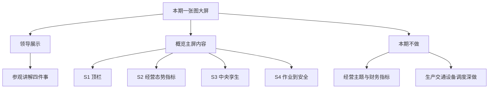
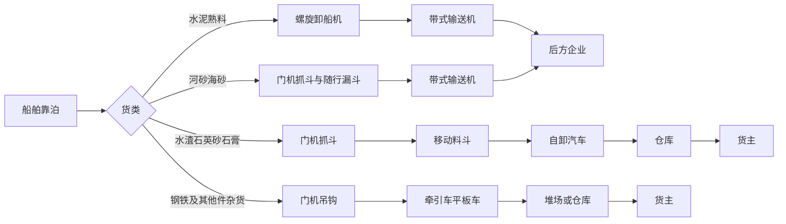
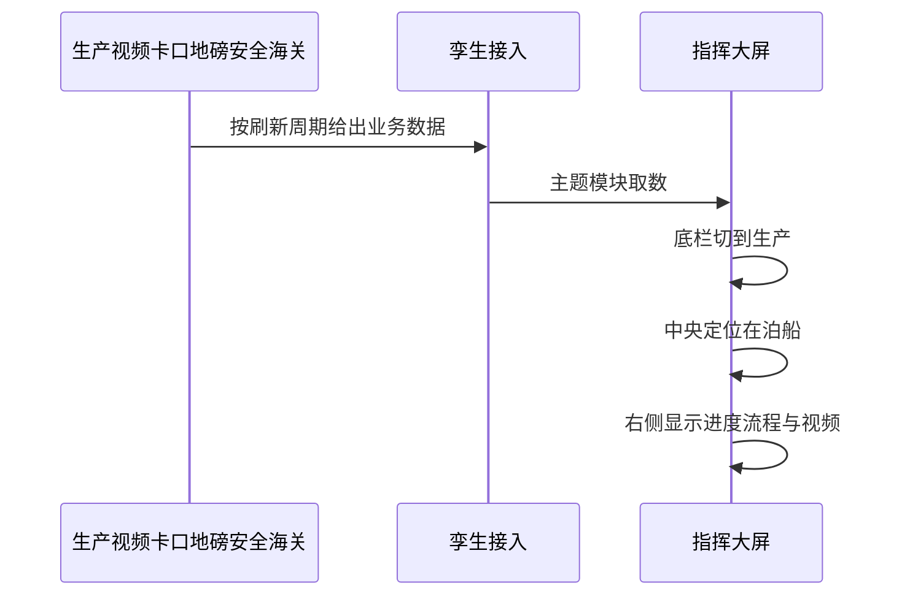
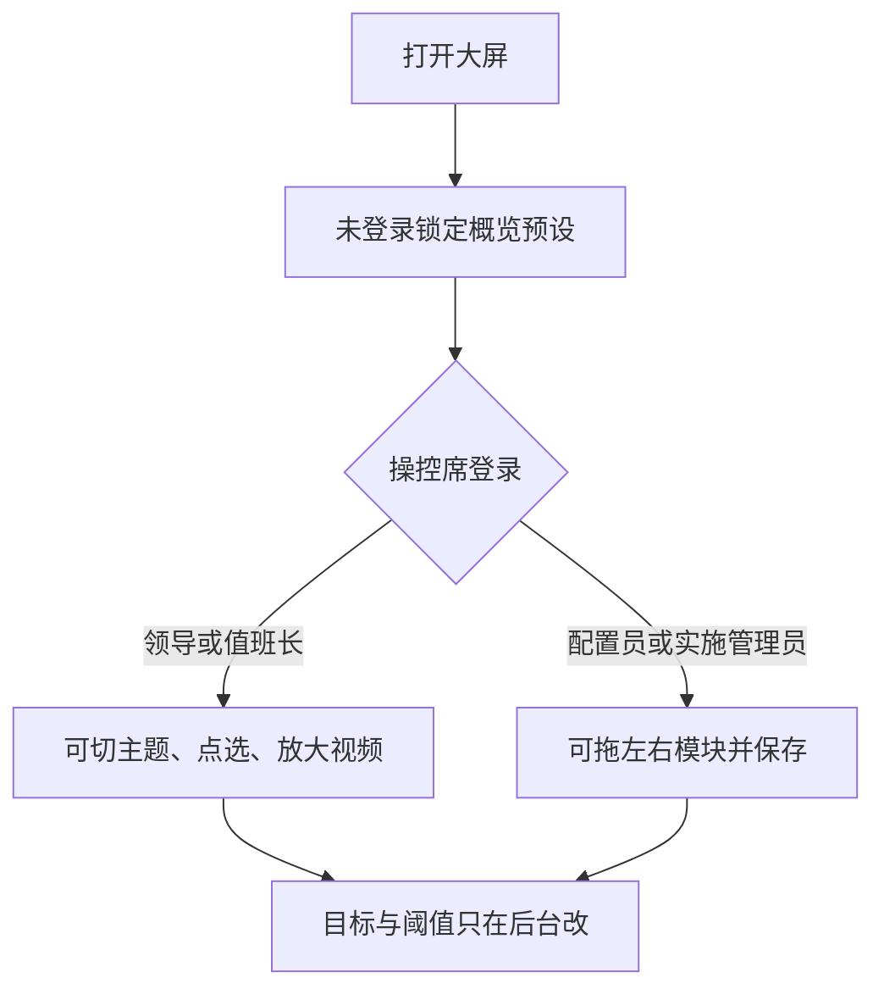
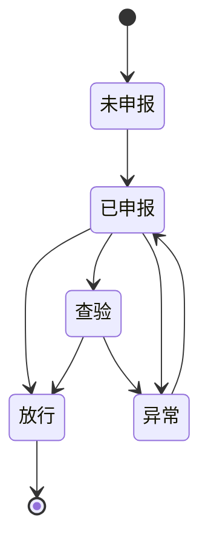

# 海南金牌港指挥运营大屏方案

| 项目 | 内容 |
|---|---|
| 版本号 | v1.0.0 |
| 更新日期 | 2026-11-07 |
| 文档状态 | 本期「一张图大屏」领导展示方案已闭合；屏体硬件仍以《大屏拼接方案》为准 |
| 适用对象 | **领导展示 / 参观讲解**（本期）；值班操控为后续扩展 |
| 屏体 | 兴盛单墙，16:9，逻辑分辨率 5760×3200；逻辑槽位 S1–S4（本期取消常驻底栏 S5） |
| 内容来源 | 技术规格书（重点 3.2.3 港区概览一张图）、码头/陆域施工图、武穴模板及 `Display_Wall`、本期原型确认 |

## 结论

本期只做 **一张图大屏方案**，对齐技术规格书 **「港区概览一张图」**，用途定为 **领导展示**：一面墙讲清港区当前态势，不展开六主题深做，**经营主题本期不做**。

屏体仍是一块 16:9 墙。武穴只学指标摆放、点选联动与断数兜底，不照搬超长条双屏 / 三页 / 铁水联运 / 水文。

领导展示要一眼看懂四件事：

1. **谁在靠、卸到哪一步**（2 个泊位，四条工艺）。
2. **货在皮带、堆场还是车上**（资源与堆存）。
3. **告警与通关能否立刻定位**（安全摘要 + 一级告警上图）。
4. **年 / 季 / 月吞吐量相对目标走到哪**（模拟目标，后台可改）。

不设收入、成本、利润；不设铁水联运、长江水文、迎宾/常态/应急三模式；不上 OA；大屏只读、不下发控制。

---

## 0. 本期范围（2026-11-07 确认）

| 项 | 口径 | 优先级 |
|---|---|---|
| 交付物 | 《一张图大屏》领导展示内容方案 + 概览屏原型调优 | P0 |
| 规格对齐 | 技术规格书 3.2.3 港区概览一张图（多源融合、视频空间化、资源可视、实时态势、查询定位） | P0 |
| 用途 | 领导展示、参观讲解；默认播「概览」官方预设 | P0 |
| 经营 | **本期不做**（主题入口可灰显或隐藏，不做经营分析页与财务指标） | P0 |
| 生产/交通/设备/调度 | 仅保留入口与讲解跳转能力；本期不单独深做主题内容包 | P1 |
| 天气 | 顶栏右侧「通航气象·7日」，演示数据；业主另给气象源后再换真数 | P1 |
| 主题入口 | 顶栏标题两侧，一边 3 个：左「概览 / 生产 / 交通」，右「设备 / 经营 / 调度」；经营本期不可进入 | P0 |
| 底栏 | **取消常驻底栏**（原主题条、健康灯一行）；接口健康并入顶栏或右下角弱提示即可 | P0 |
| 地图注释 | 不常驻「本期只统计…」类说明文字 | P0 |
| 图例 | 地图右下角，不含「总图一区」 | P0 |

文字解读：本期把规格里的「概览一张图 + 指挥态势」收成一面领导展示墙。主题入口保留形态，经营点进去提示「本期未开放」。其它主题可链到已有主题页做讲解，但不纳入本期验收深度。

---

## 1. 已定口径

| 项 | 口径 | 依据 |
|---|---|---|
| 地点与分期 | 临高金牌港开发区，本期为一期前期运营 | 技术规格书 |
| 泊位 | 2 个 7 万吨级通用泊位，水工按靠泊 10 万吨级散货船 | 技术规格书 |
| 年设计吞吐量 | 700 万吨 | 技术规格书 |
| 防波堤 / 护岸 | 防波堤约 1080 米，护岸 714.3 米 | 技术规格书 |
| 终端 | 只做 PC 与指挥大屏 | v1.0.0 总入口 |
| 海关 | 本期纳入展示（在港船通关五态） | v1.0.0 总入口 |
| 经营 | **本期不做**；规格中的收入成本永不进领导展示墙 | 2026-11-07 确认 |
| 屏体 | 单墙；本期逻辑四槽（顶/左/中/右），主题入口在顶栏 | 《大屏拼接方案》+ 2026-11-07 |
| 不做 | OA、经营主题、独立数据中台产品、替代生产系统下发控制 | 产品方案 + 本期确认 |
| 吞吐目标 | 年 / 季 / 月目标用模拟数，独立后台配置 | 2026-11-06 确认 |
| 疏运方式 | 取每条作业指令，不按货类猜测 | 2026-11-06 确认 |
| 待泊展示词 | 预报、锚地、待靠、已排泊；与生产系统原文的对应放后台 | 2026-11-06 确认 |
| 堆场告警 | 利用率低于 70% 正常，70%–90% 关注，达到 90% 预警 | 2026-11-06 确认 |
| 通关 | 只挂在港船；状态见第 14 章 | 2026-11-06 确认 |
| 皮带流量 | 以生产系统为准 | 2026-11-06 确认 |
| 视频位置 | 常驻右侧，不放底栏 | 2026-11-06 确认 |
| 拖模块 | 仅大屏配置员、实施管理员；领导展示账号只看切讲 | 2026-11-06 确认 |
| 通航气象 | 顶栏右侧 7 日卡片；演示数据 | 2026-11-07 确认 |
| 主题入口 | 标题左右各 3 枚；经营灰显不可进 | 2026-11-07 确认 |
| 环境 / 水位风速 | 概览右栏可展示作业相关水位、门机风速（演示） | 原型确认 |

《产品方案》正文里「海关是否本期对接」若仍标待确认，本方案按总入口：海关状态上墙（可模拟）。

---

## 2. 从武穴模板学什么

武穴模板原文是「一屏五域」：视频、地图、作业、设备、安防环境，外加专题页。`Display_Wall` 落地后拆成宏观翻牌、运行细节、全货类统计三页，并配指标说明。金牌港把这三页的**内容能力**收进同一面墙的主题里。

| 武穴已落地能力 | 金牌港落点 | 处理 |
|---|---|---|
| 顶栏日期、时间、数据截至 | S1 | 保留 |
| 年 / 月 / 日吞吐量翻牌与完成率 | 概览、经营的 S2 | 保留；分母来自后台配置，初始为模拟目标 |
| 在泊表 + 待泊表、作业进度条 | 生产主题 S2 / S4 | 保留；泊位只有 2 个 |
| 集疏港占比、货种排行、月度趋势 | 生产、经营 | 保留；疏运方式改为皮带直送 / 汽车，不写铁路 |
| 堆场利用率、平均堆存天数 | 生产 | 利用率按容量计算；不照搬武穴「万标箱当量系数」 |
| 中央地图点选船舶、设备、堆场、视频 | S3 → S4 | 保留，主视改为三维孪生，二维为辅 |
| 设备五态、完好率、故障率 | 设备主题 | 保留口径；设备清单改为卸船机、门机、皮带机 |
| 告警分级、未闭环列表、处置率 | 调度、概览 S4 | 保留 |
| 视频多路、在线 / 离线、点选放大 | 右侧 S4 | 保留；不放底栏。点位以工业电视图纸为准 |
| 卡口、地磅 | 交通主题 | 武穴弱、金牌港强，升为交通主指标 |
| 铁水联运顶栏、铁路列数 | — | 不搬。图纸与规格书无铁路专用线 |
| 6 泊位、1800 万吨、9 万 TEU | — | 不搬 |
| 吴淞潮位、UKC、丰枯水裕量 | — | 不搬。资料未要求水文专题 |
| 集装箱多式联运占比环图 | — | 不作为主指标。箱号识别、箱位仅在有业务数据时展示 |
| 迎宾 / 常态 / 应急三模式 | — | 不设。已有拼接方案明确取消 |
| 收入、光伏、碳排 | — | 不设 |
| AI 安全帽、烟火、越界 | 调度 | 规格书未强制算法，放 P2，无数据则不上墙 |

视觉沿用武穴已落地色值，保证远距可读：背景 `#051838`，主蓝 `#0E74F0`，高亮 `#00E4FF`，正常 `#00C48C`，预警 `#FFAA00`，告警 `#F53F3F`，字色白 / `#B4C7E7`。模板 Word 里的另一套蓝仅作参考，不混用。

---

## 3. 港区对象（上图范围）

以下对象来自码头分册、陆域分册施工图，作为 S3 图层和点选对象，不把电气原理图搬上大屏。

| 区域 | 对象 | 大屏用途 |
|---|---|---|
| 码头 | 2 个泊位、引桥、泊位前沿 | 靠泊状态、作业进度 |
| 码头 | 卸船机 / 门机接电、高低压岸电箱 | 设备与岸电状态 |
| 码头 | 2# 变电所（门机、卸船机及低压；2×315 kVA） | 供电状态，P1 |
| 码头 | T1 转运站，BM1 / BM2 皮带，BM3 预留，BH1 廊道 | 流程动画；BM3 默认不作为在运设备 |
| 码头 | 前沿变频间、中杆灯、工业电视 | 设备点、视频点 |
| 陆域 | 1# 变电所（低压设备；2×1250 kVA）、双回路 10 kV | 供电总览，P1 |
| 陆域 | T2、T3 转运站，2# / 3# 变频间 | 流程与设备 |
| 陆域 | 卡口、道闸、箱号识别、地磅房 | 交通主题主对象 |
| 陆域 | 流动机械充电箱变、汽车充电箱变 | 设备点，P1 |
| 陆域 | 监控中心、网络机房、综合楼调度（甚高频岸台） | 视频与通信状态，不展示机房平面 |
| 港区 | 堆场、仓库、道路、雨水 / 污水设施 | 堆存与分区；泵站只在告警时出现 |

负荷仅作背景，不在大屏滚动展示千瓦明细：陆域说明记载负荷总容量约 15572 kW，计算负荷约 8932 kW，装卸与消防为二级负荷，双回路供电。

---

## 4. 生产主流程（大屏要画的链路）

控制说明给出四条工艺。大屏用流程带表达，不在墙上操作启停。启停仍在控制室操作员站。

文字解读：前两类以皮带直送后方企业为主；后两类以汽车集疏运为主。大屏「疏运方式」只分**皮带直送**和**汽车疏运**。件杂货存在双向装卸，进度条仍按「已完成 / 计划」计算，装卸方向单独显示装或卸。

---

## 5. 墙上怎么摆（本期领导展示）

本期骨架：**S1 顶栏、S2 左、S3 中、S4 右**。取消常驻 S5 底栏。默认只深做 **概览一张图**；顶栏主题入口供讲解跳转，经营不可进。

文字解读：领导展示默认停在概览。切到生产/交通/设备/调度可进已有主题页讲解；经营提示未开放。中央管空间，左右管数与详情。

### 5.1 概览一张图默认模块（本期 P0）

| 槽位 | 模块 | 展示要点 | 优先级 |
|---|---|---|---|
| S1 | 顶栏 | 左：日期星期时间与数据截至；中：标题 + 两侧主题入口；右：通航气象·7日 | P0 |
| S2 | 吞吐量 | 年 / 季 / 月气泡：实际、目标、完成率 | P0 |
| S2 | 当年货类分布 | 环图 + 色点清单（占比、万吨） | P0 |
| S2 | 当年客户排行 | Top5 横条（万吨） | P1 |
| S2 | 资源占用 | 车辆待进/已进、船舶待泊/锚地、堆场利用率 | P0 |
| S3 | 中央孪生 | 全港底图、泊位/设备/堆场/卡口/告警图层；右下图例（无总图一区） | P0 |
| S4 | 正在作业 | 1# / 2# 泊位卡 + 待泊/锚地表 | P0 |
| S4 | 设备信息 | 总数与五态摘要、重点机台 | P1 |
| S4 | 环境监测 | 泊位水位、门机风速（作业相关） | P1 |
| S4 | 安全告警 | 连续安全天数、处置率卡片、未闭环 Top 列表 | P0 |

### 5.2 主题入口（顶栏）与后续扩展

| 主题 | 本期 | 说明 |
|---|---|---|
| 概览 | **深做** | 领导展示主屏，对齐规格 3.2.3 |
| 生产 | 入口可跳转 | 不纳入本期内容验收深度 |
| 交通 | 入口可跳转 | 同上 |
| 设备 | 入口可跳转 | 同上 |
| 经营 | **不做** | 按钮灰显或点击提示「本期未开放」 |
| 调度 | 入口可跳转 | 告警定位能力已含在概览右栏 |

S1 布局细则：

| 区域 | 内容 |
|---|---|
| 左侧 | 日期、星期、时间、数据截至 |
| 中央 | 左三钮「概览 / 生产 / 交通」+ 标题「海南金牌港数字孪生指挥中心」+ 右三钮「设备 / 经营 / 调度」 |
| 右侧 | 通航气象·7日（今天高亮）；不放顶栏告警红条（告警在右栏） |

单侧卡片不超过 6 块。中央不常驻大视频窗；视频仍在右侧主题扩展时接入，概览以告警与作业为主。

### 5.3 在泊 / 待泊字段（概览右栏沿用）

在泊表：

| 字段 | 展示 | 来源 |
|---|---|---|
| 船名 | 文本 | 码头生产 |
| 泊位 | 1# / 2# | 码头生产 |
| 货类 / 货种 | 熟料、矿建材料、非金属矿石、件杂货等 | 码头生产 |
| 装卸 | 装 / 卸 | 码头生产 |
| 作业量 | 吨 | 码头生产 |
| 进度 | 进度条 + 百分比 | 已完成 / 计划 |
| 疏运方式 | 皮带直送 / 汽车 | 该船当前作业指令。指令未写时显示「—」，不按货类填 |

待泊表：船名、货类、计划量、预计靠泊、状态。墙上只显示四个词：预报、锚地、待靠、已排泊。生产系统若用别的原文，在后台做对照，墙上不出现对不上的编码。对不上的原文先原样显示，同时记入待映射清单。

泊位色：空闲、占用、作业中、待离泊。与规格书生产一张图一致。

进度条颜色沿用武穴：100% 完成，70%–99% 高，30%–69% 中，30% 以下低。

---

## 6. 指标字典

空值统一显示「—」。演示数据未换成接口前，模块角标「演示数据」。

| 模块 | 指标 | 单位 | 来源 | 刷新 | 优先级 |
|---|---|---|---|---|---|
| 顶栏 | 日期、星期、时间 | — | 本机时钟 | 1 秒 | P0 |
| 顶栏 | 数据截至 | — | 各接口最新成功时间中的最早者 | 随数据 | P0 |
| 概览 | 年累计吞吐量 | 吨 | 码头生产 | 5–15 分钟 | P0 |
| 概览 | 季 / 月累计吞吐量 | 吨 | 码头生产 | 5–15 分钟 | P0 |
| 概览 | 完成率 | % | 实际 ÷ 后台目标 | 随吞吐 | P0 |
| 概览 / 生产 | 在泊船数、待泊船数 | 艘 | 码头生产 | 1–5 分钟 | P0 |
| 概览 / 生产 | 泊位状态 | — | 码头生产 | 1–5 分钟 | P0 |
| 生产 | 作业进度 | % | 码头生产 | 1–5 分钟 | P0 |
| 生产 | 货种排行 | 吨 | 码头生产 | 1 小时或日批 | P0 |
| 生产 | 月度吞吐趋势 | 万吨 | 码头生产 | 1 小时或日批 | P1 |
| 生产 | 集港量、疏港量及占比 | 吨、% | 码头生产 | 1 小时 | P1 |
| 生产 | 疏运方式占比 | % | 码头生产 | 1 小时 | P1 |
| 生产 | 堆场库存、利用率 | 吨、% | 码头生产 | 5–15 分钟 | P0 |
| 生产 | 分货类平均堆存天数 | 天 | 码头生产 | 日批 | P1 |
| 生产 | 皮带流程状态、瞬时量、累计吨 | —、吨/时、吨 | 生产系统 | 1–5 分钟 | P0 |
| 交通 | 今日进港、出港、在港车辆 | 辆 | 卡口 / 道闸 | 1–5 分钟 | P0 |
| 交通 | 过磅车次、过磅重量 | 辆、吨 | 地磅 | 1–5 分钟 | P0 |
| 交通 | 抬杆结果、抓拍 | — | 道闸 | 1–5 分钟 | P1 |
| 交通 | 轨迹回放 | — | 定位或卡口序列 | 按查询 | P1 |
| 交通 | 拥堵提示 | — | 视频或定位 | 1–5 分钟 | P2 |
| 设备 | 运行、待机、预警、故障、检修台数 | 台 | 设备物资 | 1–5 分钟 | P1 |
| 设备 | 完好率、故障率 | % | 设备物资 | 1–5 分钟 | P1 |
| 设备 | 利用率 | % | 运行时长 / 可作业时长 | 1–5 分钟 | P2 |
| 设备 | 岸电占用、变电所进线状态 | — | 供电监控，若无接口则不做 | 5–15 分钟 | P1 |
| 经营（本期不做） | 船时 / 台时 / 泊位利用率等 | — | — | — | 不做 |
| 调度 | 告警条数、未闭环、处置率 | 条、% | 安全系统 | 1–5 分钟 | P0 |
| 调度 | 事件位置 | — | 安全 / 生产 / 视频 | 1–5 分钟 | P0 |
| 调度 / 生产 | 通关状态 | — | 海关通关辅助；未接前用模拟 | 1–5 分钟 | P0 |
| 调度 | 环境、在岗人数、广播分区 | — | 本期模拟 | 1–5 分钟 | P1 |
| 视频 | 在线、离线、故障 | — | 工业电视 | 1–5 分钟 | P0 |
| 调度 | 应急物资与队伍 | — | 安全系统 | 5–15 分钟 | P2 |

船位若生产系统已含 AIS，大屏直接用，不另接一套 AIS。规格书要求船舶位置由码头生产管理系统提供。

---

## 7. 计算与状态

计算规则如下。目标、容量、限值以后台配置为准，表中的吨位和小时是模拟初始值。

| 指标 | 算法 | 说明 |
|---|---|---|
| 完成率 | 实际 ÷ 目标 × 100%，保留 1 位小数，显示上限 999.9% | 目标为 0 时显示 0%。目标只读后台。模拟初始值：年 700 万吨，月 58.3 万吨，日 1.9 万吨 |
| 作业进度 | 已完成量 ÷ 计划量 × 100%，取整 | 同一条船单位必须一致，本期为吨 |
| 集港占比 | 集港 ÷（集港 + 疏港），四舍五入取整 | 疏港占比 = 100% − 集港占比；合计为 0 时两边都为 0% |
| 堆场利用率 | 当前库存 ÷ 设计容量 × 100% | 散货、件杂按吨。箱位有业务后再单算，不与吨混成一个数 |
| 堆场色阶 | 低于 70% 正常，70%–90% 关注，达到 90% 预警 | 已确认作为正式告警线。达到 90% 出三级告警。容量为模拟初始值：散货堆场 80 万吨、件杂堆场 15 万吨、仓库 10 万吨，后台可改 |
| 船时效率 | 已完成装卸吨 ÷ 装卸作业小时 | 作业小时从开工到当前或完工，减去作业指令里的停工小时。没有停工记录时不扣。经营区展示在泊船平均 |
| 台时效率 | 该机本日完成吨 ÷ 该机本日运转小时 | 运转小时取生产系统作业实绩。展示卸船机、门机；经营区展示当日平均 |
| 完好率 | （设备总数 − 故障台数）÷ 总数 | 检修不计入故障 |
| 故障率 | 故障台数 ÷ 总数 | 与完好率同一口径 |
| 处置率 | 已处置 ÷ 当日告警总数 | 当日 0 条告警时显示「—」，不显示 0% 或 100% |
| 月度趋势 | 1–12 月，当前月之后不画点 | 统计图用万吨，翻牌用吨，换算在接入层完成 |
| 货种排行 | 按作业量降序 | 默认当前月，可切本季、本年 |

告警等级：

| 等级 | 颜色 | 含义 | 墙上行为 |
|---|---|---|---|
| 一级 | 红 | 设备故障停机、安全事件、环境超限 | 顶栏摘要 + 中央定位 + 右侧详情 |
| 二级 | 橙 | 设备异常、作业延误 | 列表置顶 |
| 三级 | 黄 | 接近阈值 | 列表展示，不打断主视 |

设备状态：运行、待机、预警、故障、检修。五态之和等于设备总数。

视频状态：在线、离线、故障。离线标红，保留最后一次成功画面或明确的离线占位。

---

## 8. 场景

### 8.1 正常

文字解读：源系统负责业务数据。大屏只读、只定位、只讲解。操控席登录后切换主题不用重新登录。点船、点皮带、点摄像头，右侧模板跟着变，中央不跳走。

### 8.2 边界

| 场景 | 处理 |
|---|---|
| BM3 为预留皮带 | 模型可在，默认灰色，不计入完好率分母 |
| 只有 2 个泊位 | 在泊表最多 2 行，不预留 6 泊位空位 |
| 件杂货双向作业 | 进度与装卸方向分开，不把装和卸合成一个无方向的量 |
| 箱号识别有设备、箱业务未开展 | 交通主题不出现箱量 KPI；识别结果仅在卡口详情里 |
| 海关有船无状态 | 该船通关字段显示「—」，不判为异常 |
| 某主题接口未到 | 主题仍可进，缺的模块写「待接入」，其它模块继续刷新 |
| 模型尚未覆盖全港 | 先保证泊位、皮带、卡口、堆场可点 |
| 后台把某项目标设成 0 | 该项不显示完成率 |
| 作业指令没写疏运方式 | 该船疏运显示「—」 |
| 领导或值班登录后拖模块 | 模块回弹，布局不变 |
| 配置员拖模块 | 可改左右卡片顺序并保存；中央主场景不能拖走 |

### 8.3 异常兜底

| 场景 | 处理 |
|---|---|
| 单个接口失败 | 保留上次成功值，角标「数据延迟」，顶栏可见数据截至时间停住 |
| 长时间无数据 | 数字改为「—」，模块变灰，不留假数滚动 |
| 中央场景打不开 | 左右指标仍用缓存；中央给出失败说明 |
| 视频中断 | 点位标红，不全屏黑场 |
| 坐标对不上 | 该点进问题清单，不拖垮其它图层 |
| 告警定位无坐标 | 列表仍显示，地图不乱飞 |
| 当日无告警 | 未闭环为 0，处置率显示「—」 |

---

## 9. 数据从哪来

大屏不直接采集。规格书写明：车辆、生产、船舶、设备、安全告警由码头生产、设备物资、安全系统统一管理后再给孪生。

| 数据 | 提供方 | 大屏使用方式 |
|---|---|---|
| 船舶、靠离泊、装卸进度、堆场、吞吐 | 码头生产管理系统 | 概览、生产、经营 |
| 船舶位置 | 码头生产管理系统（含其 AIS） | 中央船位 |
| 卸船机、门机、皮带台账与状态 | 设备物资管理系统 | 设备主题 |
| 皮带流程状态、流量、累计吨 | 生产系统 | 生产流程带。与控制系统不一致时，墙上只显示生产系统 |
| 环境、人员、广播 | 本期模拟数据 | 调度主题。正式点位台账到位后，只换数据来源 |
| 告警 | 安全管理系统 | 概览、调度 |
| 实时视频 | 工业电视 / 视频平台 | 点选即看、轮播 |
| 进出记录、抓拍、抬杆 | 卡口、道闸 | 交通 |
| 过磅 | 地磅 | 交通、可与生产吨数对照 |
| 通关状态 | 海关通关辅助系统；未接前用模拟 | 只挂在港船，五个状态见第 14 章 |

刷新总原则：时钟 1 秒；在泊、今日量、告警、卡口 1–5 分钟；月年统计 5–15 分钟；趋势和排行按小时或日批。不把武穴模板里的「5 秒刷新一切」直接套到全部指标。视频流本身按平台实时，业务数字不跟视频同一频率。

---

## 10. 优先级（本期领导展示一张图）

| 优先级 | 上墙内容 |
|---|---|
| P0 | 概览一张图：顶栏（含气象与主题入口）、年季月吞吐与完成率、货类分布、资源/堆场、2 泊位作业与待泊、安全天数与未闭环摘要、中央图层与点选、通关五态（可模拟） |
| P1 | 客户排行、设备摘要、水位风速、视频点选即看、其它主题讲解页跳转、扫码遥控 |
| 本期不做 | **经营主题及一切收入/成本/利润指标**；经营异常预警；应急资源调度下发；广播对讲；AI 识别 |
| P2（后续） | 拥堵预警、设备健康评分、利用率深度分析、多系统联动指挥深化 |

P1 数据晚到显示「待接入」或演示角标。经营入口灰显不算验收失败。

---

## 11. 和武穴交付方式的对应

武穴每个屏有页面，也有一份指标说明，演示数据和正式接口分开，失败时不把页面打空白。金牌港建议同样交付，但页面按主题而不是按三块长屏：

| 交付 | 说明 |
|---|---|
| 一张图主屏 | 领导展示概览墙（S1–S4），对齐规格 3.2.3 |
| 主题入口 | 顶栏六钮；经营灰显；其它可跳转已有讲解页 |
| 指标说明 | 本期上墙指标写清名称、单位、来源、刷新、公式 |
| 演示数据 | 未联调前可打开，角标明确 |

本期以本方案 + 概览原型为准；经营主题不交付。

---

## 12. 风险

| 风险 | 影响 | 处理 |
|---|---|---|
| 把武穴铁路、水文、箱量目标抄进金牌港 | 汇报口径错误 | 以本章裁剪表为准 |
| 模拟目标被当成正式考核 | 完成率只对内演示有效 | 页面角标「演示数据」；正式目标只从后台改 |
| 生产系统尚无皮带流量 | 流程带没有数 | 显示「—」，不用控制系统的数顶上 |
| 箱号识别被理解成以集装箱为主 | 范围膨胀 | 箱业务未确认前不设箱量 KPI |
| 经营被要求本期上墙 | 与 2026-11-07 确认冲突 | 经营主题不做；财务指标永不进领导墙 |
| 六主题同时要求实数验收 | 接口不齐无法收口 | 本期只验概览 P0；其它主题仅入口 |
| 12×12 箱体与 3200 高度不能整除 | 像素对不齐 | 仍按《大屏拼接方案》待硬件终认，内容布局不依赖单箱像素 |
| 海关状态过细 | 墙上字看不清 | 只保留第 14 章五个状态 |

---

## 13. 视频与权限

### 13.1 视频放哪

右侧按点选展开视频：1# 泊位前沿、2# 泊位前沿、皮带廊道、卡口为默认候选。点某一路，仍在右侧放大，中央场景不让位。

本期无常驻底栏。主题切换在顶栏标题两侧；恢复预设、接口健康改为操控席工具或顶栏弱提示，不占领导展示主视线。

### 13.2 谁能改墙上的布局

物理大屏默认播「概览」官方预设。未登录操控席时不能拖、不能保存。登录的是操控席，不是给每个观众各看一版。

文字解读：看和讲在大屏上完成。改目标、改容量、改模拟开关、改状态对照，都进独立后台，大屏上不放配置表单。

| 动作 | 未登录 | 领导 | 值班长 | 大屏配置员 | 实施管理员 |
|---|---|---|---|---|---|
| 看大屏 | 能 | 能 | 能 | 能 | 能 |
| 切换主题（经营除外） | 不能 | 能 | 能 | 能 | 能 |
| 点选对象、放大视频 | 不能 | 能 | 能 | 能 | 能 |
| 拖动模块、保存布局 | 不能 | 不能 | 不能 | 能 | 能 |
| 恢复官方预设 | 不能 | 不能 | 能 | 能 | 能 |
| 改年 / 月 / 日目标 | 不能 | 不能 | 不能 | 能 | 能 |
| 改堆场容量与 70/90 | 不能 | 不能 | 不能 | 能 | 能 |
| 开关模拟数据 | 不能 | 不能 | 不能 | 能 | 能 |
| 维护待泊词、通关词对照 | 不能 | 不能 | 不能 | 能 | 能 |

领导账号用于参观讲解。值班长用于当班，可以把被人改乱的布局拉回官方预设，但不能改数。配置后台与大屏分开登录。

---

## 14. 通关、环境、人员、广播

### 14.1 通关状态（行业推荐）

只挂在港船，含在泊和待泊。船一离泊，从大屏列表去掉，历史留在通关系统里查。

| 墙上状态 | 含义 | 颜色 | 是否告警 |
|---|---|---|---|
| 未申报 | 已有船期，舱单或报关未申报 | 灰 | 否 |
| 已申报 | 已申报，等待审结 | 蓝 | 否 |
| 查验 | 布控或查验进行中 | 黄 | 否。超过后台配置的查验时长后改为异常 |
| 放行 | 已放行，可以装卸或离泊 | 绿 | 否 |
| 异常 | 退单、布控未解除、查验超时 | 红 | 二级告警 |

文字解读：墙上不展示报关单号、税则、金额。船舶详情只显示上述五个词之一。查验本身是正常环节，只有超时、退单、布控未解除才进告警。未接海关接口前，用模拟状态跑通这五个词。

### 14.2 环境、人员、广播（模拟）

调度主题增加三块，数据标明模拟。正式台账到了以后，模块不动，只换来源。

| 模块 | 模拟内容 | 规则 |
|---|---|---|
| 环境 | 前沿、堆场各 1 个粉尘点；前沿、堆场、卡口各 1 个噪声点 | 粉尘不超过 1.0 为达标，超过 1.0 到 1.5 为关注，超过 1.5 为超标。噪声昼间 70、夜间 55，超过即超标。限值后台可改 |
| 人员 | 前沿、廊道、堆场、卡口、综合楼五个区域人数 | 只显示人数，不上个人姓名和轨迹 |
| 广播 | 同上五个分区 | 只显示空闲或播报中。墙上不能喊话、不能切音源 |

---

## 15. 后台要单独配置的项

大屏只读这些配置。初始值都是模拟，上线前由配置员改成正式值。

| 配置项 | 模拟初始值 |
|---|---|
| 年 / 月 / 日吞吐目标 | 700 万吨 / 58.3 万吨 / 1.9 万吨 |
| 堆场与仓库容量 | 80 万吨 / 15 万吨 / 10 万吨 |
| 堆场关注线、预警线 | 70%、90% |
| 待泊词对照 | 空表。未对照时墙上用预报、锚地、待靠、已排泊 |
| 通关查验超时 | 4 小时 |
| 环境限值 | 粉尘 1.0 / 1.5；噪声昼 70、夜 55 |
| 模拟数据开关 | 开。关闭后缺接口的模块显示「—」，不再用模拟数 |
| 官方主题预设 | 本期以「概览」1 套为主；经营无预设；其它主题预设后续补 |
| 通航气象 | 演示 7 日；正式源由业主指定后再换 |

---

## 16. 【待确认】

| 编号 | 事项 | 状态 |
|---|---|---|
| 1 | 本期只做一张图大屏方案，用途为领导展示 | 已确认 2026-11-07 |
| 2 | 经营本期不做 | 已确认 2026-11-07 |
| 3 | 顶栏天气、标题两侧主题入口写入方案 | 已确认 2026-11-07 |
| 4 | 经营按钮灰显文案（「本期未开放」或直接隐藏） | 待定 |
| 5 | 正式气象数据源与刷新周期 | 待业主提供 |
| 6 | 领导展示账号是否允许切换到生产等讲解页 | 待定（建议允许只读跳转） |

模拟吞吐目标若改为业主正式值，只改后台，不改本章结构。

