# 海南金牌港设备设施一张图 · 设备详情弹窗方案

| 项目 | 设计口径 |
| --- | --- |
| 使用场景 | 领导参观演示，点选设备查看当前状态、现场画面和业务影响 |
| 大屏 | 16:9，约 7 m × 4 m。效果图为 1920 × 1080 px |
| 主屏底图 | 设备设施一张图 V7 中央视频版 |
| 弹窗样式 | 沿用参考图的深蓝底、青色高亮、六个页签及左右分栏 |
| 本轮覆盖 | V7 六类台账拆分为 11 种详情模板，公辅保障含除尘和排水两种，共 13 张独立效果图 |
| 演示快照 | 2026-11-08 14:00，与 V7 场景一致。设备编码、测点、位置和业务记录以实施接入为准 |

## 1. 弹窗结构与点选

设备状态继续在中央 BIM 上直观表达。从 BIM 标记、关键设备监测、报警中心、维保列表或公辅保障卡片点选同一设备，进入同一详情弹窗。按入口高亮相应页签，从 BIM 默认进入设备概览，从报警默认进入实时监测，从维保默认进入维修保养。点选「定位设备」回到 BIM，聚焦对应设备或点位。关闭后恢复原有视角和筛选。

| 区域 | 内容 |
| --- | --- |
| 顶部 | 设备编号和名称、业务状态、安装位置、演示数据标记、定位设备、关闭 |
| 左上 | 设备基础信息。显示设备编号、名称、台账分类、区域、责任岗位、型号、厂家及通信状态 |
| 左下 | 当前维修或维保摘要、最近保养、保养安排。维修记录与保养计划在页签内展开 |
| 右上 | 概览放 4 项设备专属指标，明确采集时刻。趋势、健康等级和测点详情在实时监测页签展开 |
| 右中 | 设备关联画面、机位名称和视频状态。参考图和本批图片中的预览为模拟画面 |
| 右下 | 当前作业、通行、计量或保障信息。重点展示正在做什么、服务谁、影响哪一环节 |

### 六个页签

| 页签 | 展开内容 |
| --- | --- |
| 设备概览 | 汇合基础信息、四项监测指标、关联视频、维保摘要和当前作业或服务 |
| 基础信息 | 完整台账、责任单位与岗位、上级设备、所属系统、安装位置、BIM 点位 |
| 实时监测 | 最新值和单位、采集时间、数据质量、历史趋势、预警事件、健康等级及评估时间 |
| 监控视频 | 关联机位切换、预览、放大和授权回看。无机位、中断和无权限各自有明确提示 |
| 维修保养 | 维修工单、最近保养、计划、预计完成、实际完成、恢复验收及历史记录 |
| 作业信息 | 按设备类型展示作业、通行、称重、供电、充电或其他保障记录。支持按时间和任务查询 |

## 2. 弹窗效果图与设备字段

概览的 4 项指标在各图中固定展示。下表的展开字段用于页签内查看，接入时以实际测点和业务接口配置。SC-01 与 SC-02 等同类型设备共用模板，按设备编码加载独立状态和数据。

| 序号 | V7 分类 | 设备模板 | 演示状态 |
| --- | --- | --- | --- |
| 01 | 卸船设备 | [卸船机 SC-01](#01-卸船机) | 运行 |
| 02 | 输送设备 | [皮带输送机 BM-01](#02-皮带输送机) | 运行 |
| 03 | 输送设备 | [输送驱动 T2-DRV](#03-输送驱动) | 运行、温升预警 |
| 04 | 供配电及岸电 | [1#变电所 PD-01](#04-变电所) | 正常供电 |
| 05 | 供配电及岸电 | [岸电装置 AD-01](#05-岸电装置) | 待机、就绪 |
| 06 | 闸口与地磅 | [道闸 GT-01](#06-道闸) | 服务中、栏杆关闭 |
| 07 | 闸口与地磅 | [地磅 WB-01](#07-地磅) | 称重中 |
| 08 | 监控与通信 | [摄像机 CAM-03](#08-摄像机) | 故障、离线 |
| 09 | 监控与通信 | [接入交换机 NET-01](#09-接入交换机) | 服务中、未关联视频 |
| 10 | 照明与充电 | [高杆灯 GL-07](#10-高杆灯) | 计划维护、通信离线 |
| 11 | 照明与充电 | [充电桩 CH-01](#11-充电桩) | 充电中 |
| 12 | 公辅保障 | [除尘装置 DC-01](#12-除尘装置) | 联动运行 |
| 13 | 公辅保障 | [排水泵 DP-01](#13-排水泵) | 自动备用、电机停止 |

### 01 卸船机

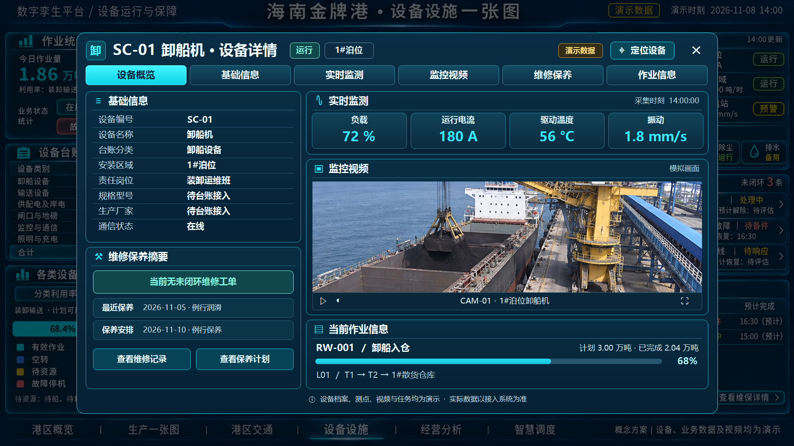

| 区域 | 设备专属字段 |
| --- | --- |
| 概览监测 | 运行负载 72%、运行电流 180 A、驱动温度 56 °C、振动 1.8 mm/s |
| 业务 | 1#泊位，当前任务 RW-001。航次计划 3.00 万吨，累计完成 2.04 万吨，进度 68%。L01 经 T1、T2 送往 1#散货仓库 |
| 展开 | 船舶与航次、任务时段、有效作业时长、班次效率、停机原因、报警与工单。视频关联 CAM-01 |

### 02 皮带输送机

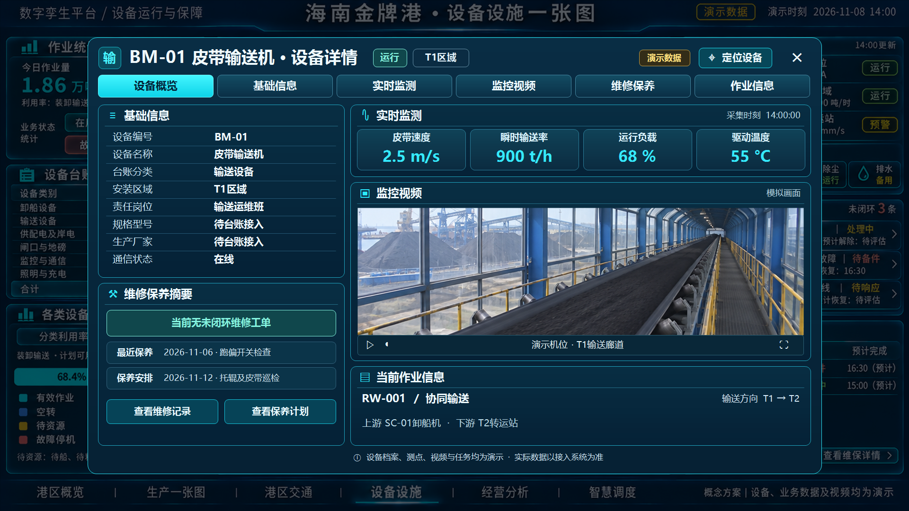

| 区域 | 设备专属字段 |
| --- | --- |
| 概览监测 | 带速 2.5 m/s、瞬时输送率 900 t/h、负载 68%、驱动温度 55 °C |
| 业务 | T1 协同执行 RW-001，连接上游 SC-01 与下游 T2。瞬时输送率用于判断当前供料节奏 |
| 展开 | 线路与方向、有效输送时长、皮带秤来源、跑偏与拉绳急停、联锁状态、托辊及皮带巡检。T1 机位为演示映射 |

### 03 输送驱动

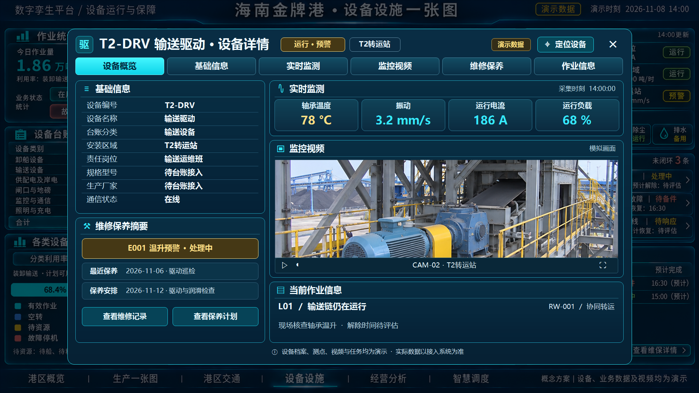

| 区域 | 设备专属字段 |
| --- | --- |
| 概览监测 | 轴承温度 78 °C、振动 3.2 mm/s、电流 186 A、负载 68% |
| 业务 | T2 驱动仍在运行。E001 温升预警处理中，L01 继续作业，解除时间待评估 |
| 展开 | 测点位置、运行工况、温振趋势、告警确认时间、处置工单和实际解除时刻。视频关联 CAM-02 |

### 04 变电所

| 区域 | 设备专属字段 |
| --- | --- |
| 概览监测 | 进线电压 10.1 kV、进线电流 68 A、变压器温度 56 °C、主变负载率 52%。按所属进线和主变标识测点 |
| 业务 | 1#变电所正常供电，当前无已确认停电作业。按馈线查看保障对象与影响范围 |
| 展开 | 进线、主变、馈线与回路标识，断路器和保护状态、用电量、停送电记录。配电室机位为演示映射 |

### 05 岸电装置

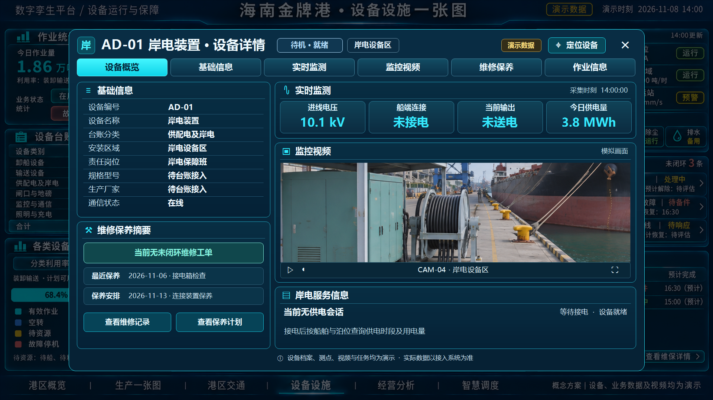

| 区域 | 设备专属字段 |
| --- | --- |
| 概览监测 | 进线 10.1 kV、船端未接电、当前未送电、今日累计供电量 3.8 MWh |
| 业务 | 设备就绪待机，当前无供电会话。累计电量来源于本日历史会话 |
| 展开 | 泊位、接电箱、船舶、供电会话、输出电压及频率、保护与联锁、起止时间和会话用电量。视频关联 CAM-04 |

### 06 道闸

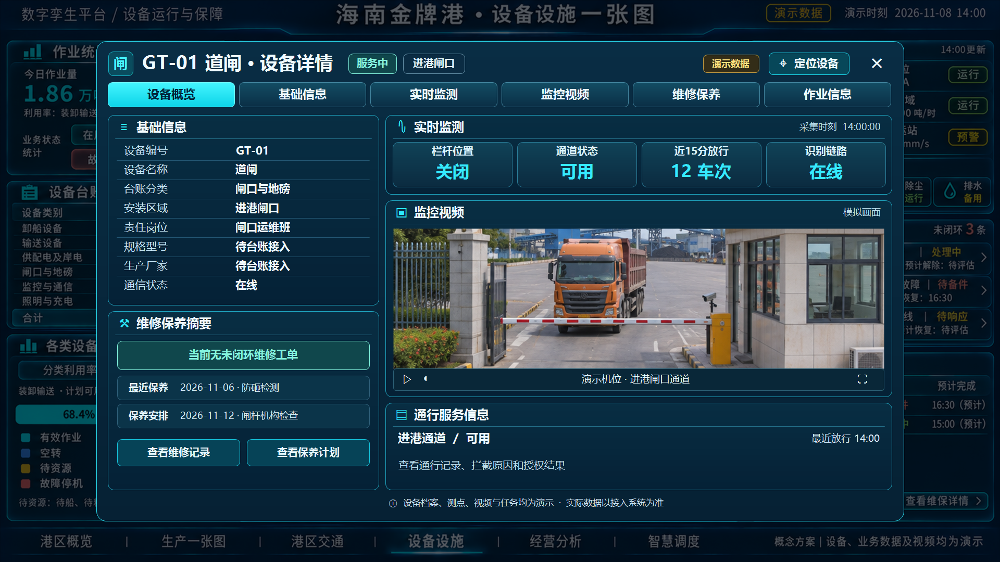

| 区域 | 设备专属字段 |
| --- | --- |
| 概览监测 | 栏杆关闭、通道可用、近 15 分钟放行 12 车次、识别链路在线 |
| 业务 | 进港通道提供通行服务，最近放行 14:00。放行量按确认通过事件统计 |
| 展开 | 通道与进出方向、授权结果、拦截原因、设备反馈、关联抓拍、防砸检测和过车记录。闸口机位为演示映射 |

### 07 地磅

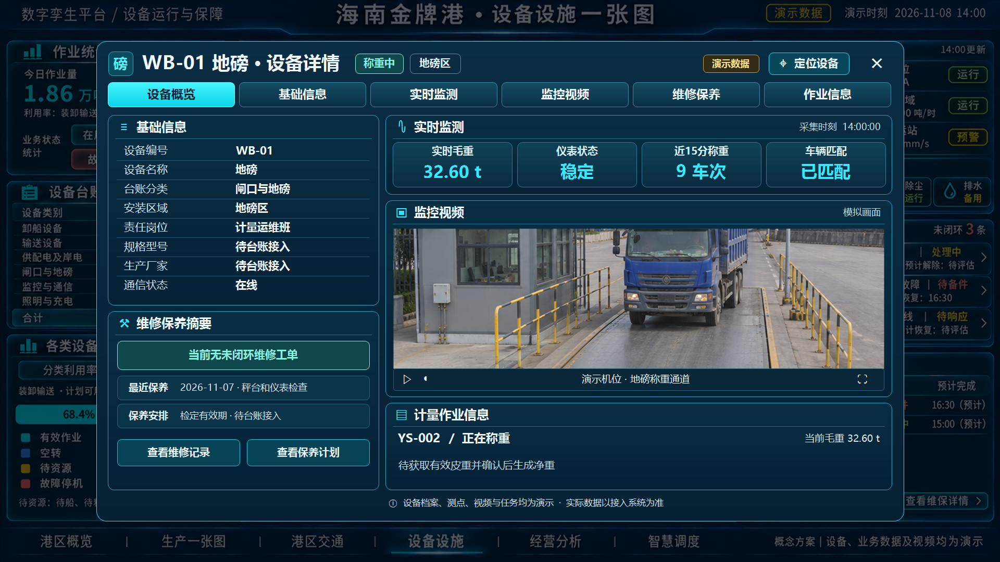

| 区域 | 设备专属字段 |
| --- | --- |
| 概览监测 | 实时毛重 32.60 t、仪表稳定、近 15 分钟称重 9 车次、车辆已匹配 |
| 业务 | YS-002 正在称重。取得有效皮重并完成确认后形成净重 |
| 展开 | 称重单号、脱敏车牌、毛重、皮重、净重、称重环节、计量异常、仪表编号与检定有效期。称重通道机位为演示映射 |

### 08 摄像机

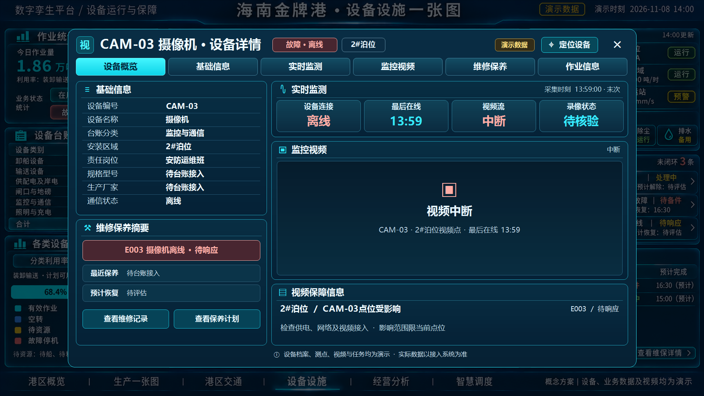

| 区域 | 设备专属字段 |
| --- | --- |
| 概览监测 | 设备离线、最后在线 13:59、视频流中断、录像状态待核验 |
| 业务 | E003 待响应，影响 2#泊位 CAM-03 视频点位，恢复时间待评估 |
| 展开 | 通道编号、设备心跳、拉流状态、录像可用性、供电与网络排查、历史回看。当前预览显示中断提示 |

### 09 接入交换机

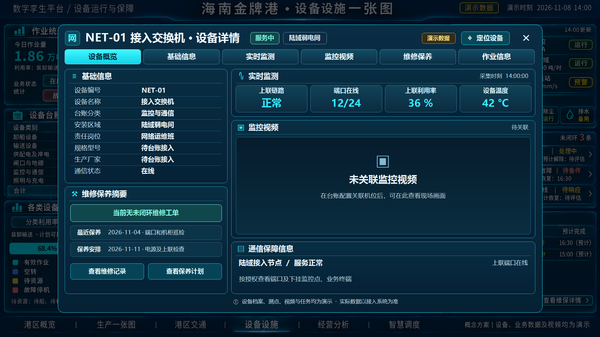

| 区域 | 设备专属字段 |
| --- | --- |
| 概览监测 | 上联正常、在线端口 12/24、上联利用率 36%、设备温度 42 °C |
| 业务 | 陆域接入节点服务正常，可按权限查看所承载的视频点和业务终端 |
| 展开 | 上联节点、端口映射、流量、错误包、下挂设备、变更与中断记录。当前未关联监控视频 |

### 10 高杆灯

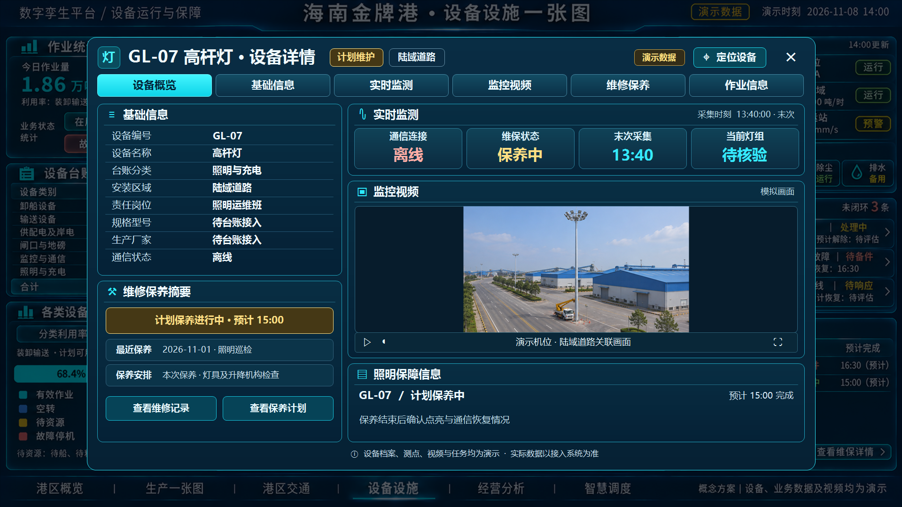

| 区域 | 设备专属字段 |
| --- | --- |
| 概览监测 | 通信离线、计划保养进行中、末次采集 13:40、当前灯组状态待核验 |
| 业务 | 陆域道路 GL-07 保养预计 15:00 完成，结束后核验照明与通信恢复情况 |
| 展开 | 照明回路、灯组、控制模式、开关计划、运行时长、升降机构保养和恢复验收。画面为道路关联机位 |

### 11 充电桩

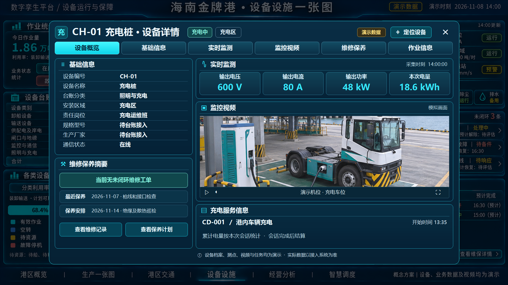

| 区域 | 设备专属字段 |
| --- | --- |
| 概览监测 | 输出 600 V、80 A、48 kW，本次会话电量 18.6 kWh |
| 业务 | 港内车辆会话 CD-001，开始时间 13:35。按会话统计电量 |
| 展开 | 枪口编号、会话状态、功率曲线、结束时间、结束原因和故障保护。充电车位机位为演示映射 |

### 12 除尘装置

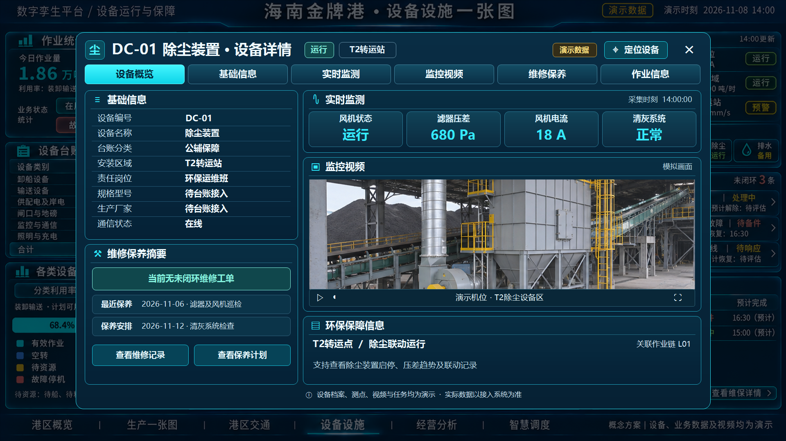

| 区域 | 设备专属字段 |
| --- | --- |
| 概览监测 | 风机运行、滤器压差 680 Pa、风机电流 18 A、清灰系统正常 |
| 业务 | T2 转运点除尘联动运行，关联 L01。异常时按已确认的保障范围提示 |
| 展开 | 服务转运点、风机与清灰模式、启停记录、滤器压差趋势、联动状态及滤材维保。测点按实际除尘工艺配置 |

### 13 排水泵

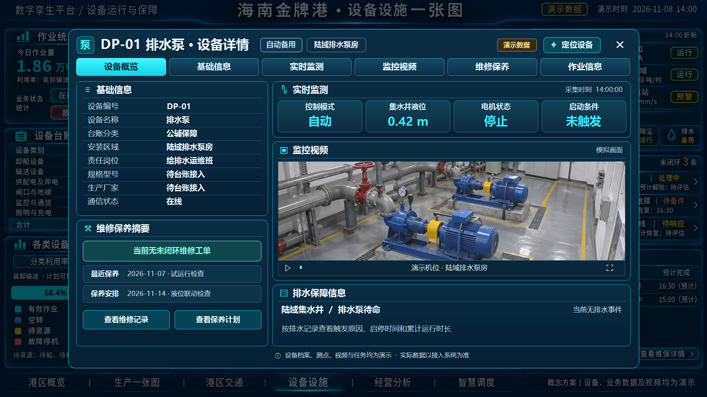

| 区域 | 设备专属字段 |
| --- | --- |
| 概览监测 | 自动模式、集水井液位 0.42 m、电机停止、启动条件未触发 |
| 业务 | 陆域集水井排水泵自动待命，当前无排水事件 |
| 展开 | 集水井与泵组关系、主备策略、液位趋势、排水触发、启停时刻、运行时长和液位联动试验 |

## 3. 数据对接与展示规则

| 数据 | 接入和使用规则 |
| --- | --- |
| 台账与空间 | 以唯一设备编码关联设备物资管理系统、BIM 对象、责任单位、上级设备与关联机位。T2 输送驱动若为皮带机部件，按父子关系建档，台账计数采用统一资产粒度。公辅对象是否计入主屏台账，以确认后的分类映射为准 |
| 监测与通信 | 从设备控制、物联或相应监控系统读取值、单位、测点位置、采集时间与质量标记。业务状态、通信状态、告警和维保分别表达。离线后标注末次时刻，缺失或过期数据按状态展示，已确认的零值可显示为 0 |
| 健康与告警 | 健康等级及告警阈值使用已配置模型、工况和来源，规则缺失时显示待配置。报警以事件编号关联影响对象、响应和恢复结果。E001、E003 与 V7 主屏使用相同事件 |
| 工单与维保 | 对接设备物资管理系统。区分保养计划、维修工单和告警待响应。预计时间与实际完成分字段，恢复以验收或复核记录为准 |
| 作业与服务 | 对接生产任务、交通通行、计量、岸电、充电或公辅系统。按任务、会话或事件归集。RW-001 卸船与输送的同批货量共享完成量口径，利用率按设备类型展示计划可用时长和有效服务时长 |
| 视频 | 关联设备自身通道或覆盖其工作区域的独立机位，标注来源和画面时间。缺少关联时显示「未关联监控视频」，设备流中断时显示「视频中断」。历史帧如获授权展示，注明历史时间 |
| 参观展示 | 大屏采用只读访问。车牌、班组个人信息和受限视频按参观权限脱敏或隐藏 |

## 4. 核对与验收

- 核对同一设备从 BIM、报警、监测或维保进入时，编号、位置、状态和事件一致。
- 核对 SC-01 的任务进度为 2.04 ÷ 3.00 = 68%，BM-01 和 T2 的关联任务只展示各自环节的数据。
- 核对 T2 仍在运行、CAM-03 视频中断、GL-07 计划维护且离线、DP-01 自动备用四类状态可以清楚区分。
- 核对开关量、时效、计量单位与业务口径。岸电「就绪」与「供电中」分别展示，地磅按称重环节确认毛重和净重。
- 在现场观看距离检查页签、关键数值和状态标签，确认单次点选能查看详情并返回原主屏视角。

## 5. 依据与范围

技术规格书 3.2.6.1 对应运行状态和档案关联，3.2.6.2 对应健康评估和故障预警，3.2.6.3 对应作业时长、效率和利用率。供电、岸电、照明、通信与控制图纸用于核对系统关系和区域。门机、移动装卸机械、电动三通等工艺对象待一期资产清册确认后，按相同规则补齐模板及点位映射。

- [数字孪生平台技术规格书 标注版](<../../../2-附件1、海南金牌港开发区港口及配套工程项目数字孪生平台技术规格书-标注.docx>)
- [码头供电照明、通信控制图纸](<../../../附件3、09-1+码头供电照明、通信控制图纸.pdf>)
- [陆域供电照明、通信控制图纸 标注版](<../../../3-附件4、09-2+陆域供电照明、通信控制图纸 - 标注.pdf>)
- [设备设施一张图 V7 中央视频版](../海南金牌港_设备设施一张图_V7_中央视频版.png)
